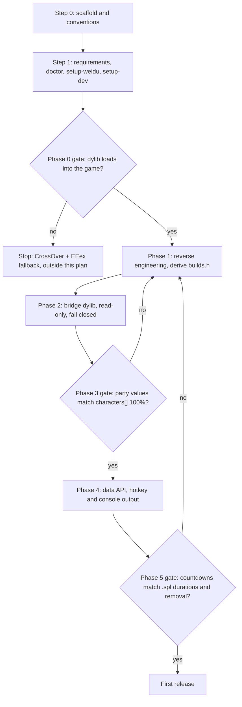
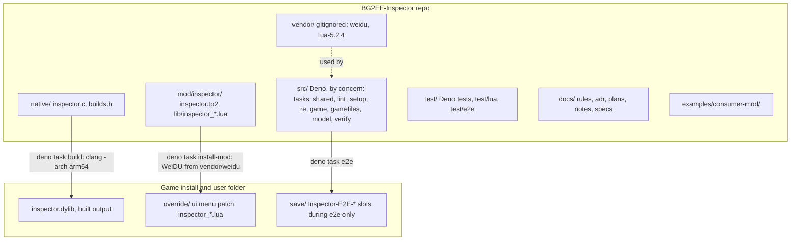
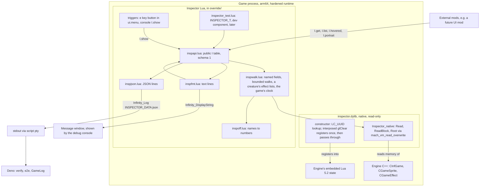
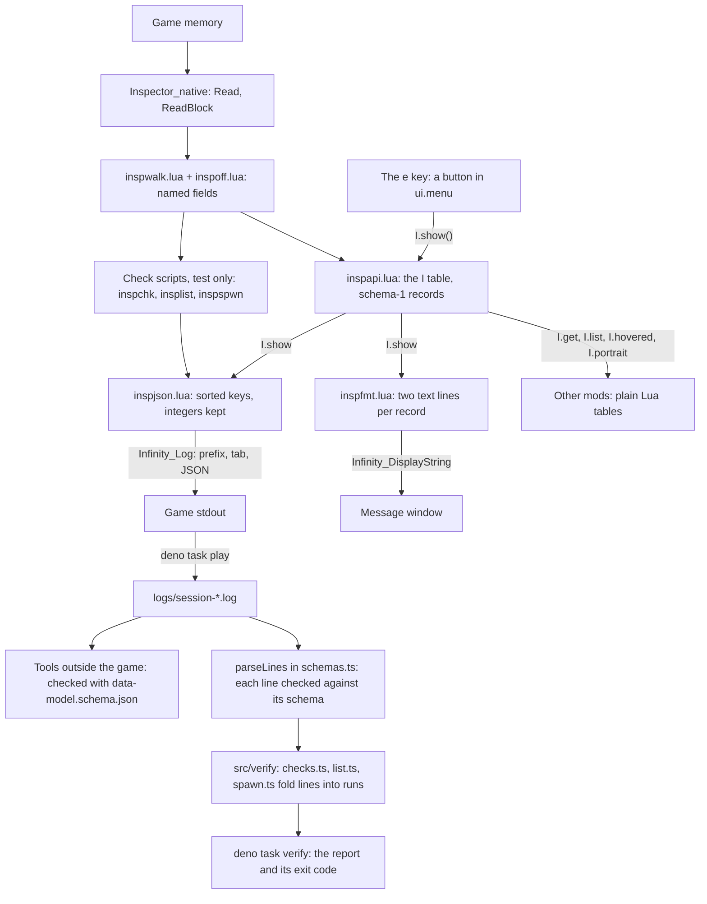
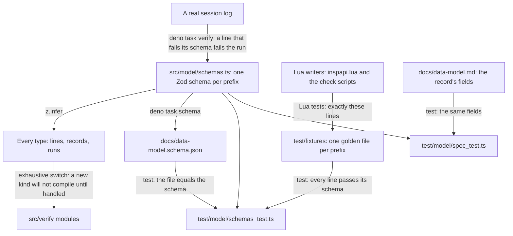
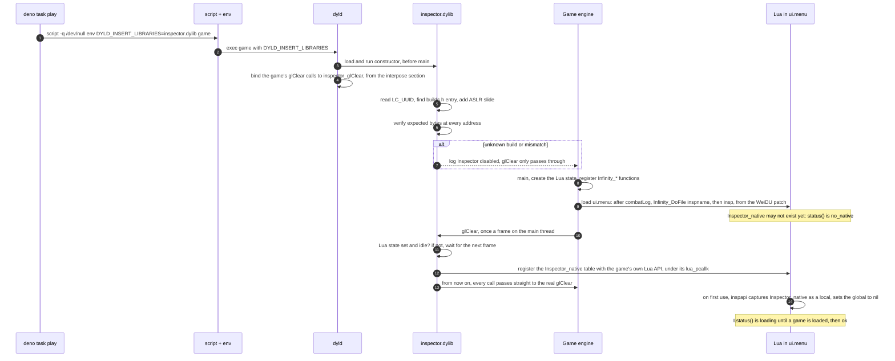
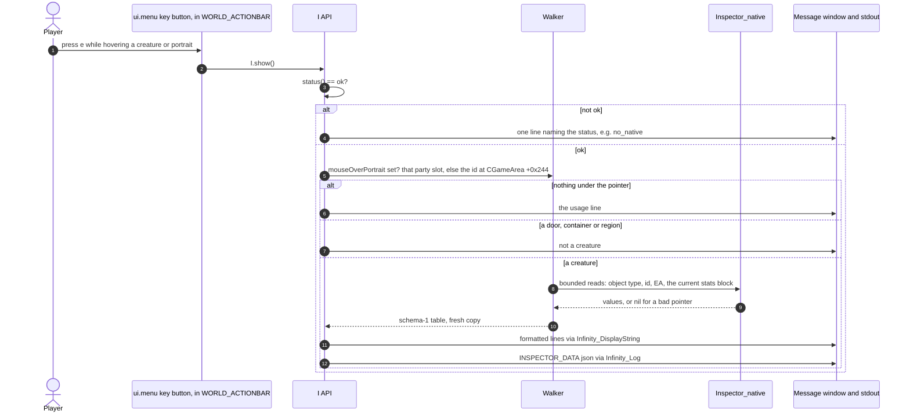
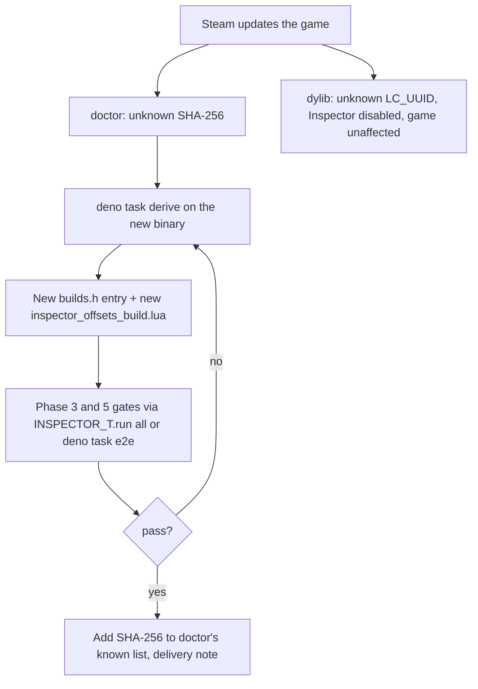

# Architecture

How the inspector fits together, what runs where, and the order things happen in. Each diagram is a
Mermaid block, which GitHub renders and VS Code previews with a Mermaid extension. The decisions behind
these diagrams are in [ADR-0001](adr/0001-native-dylib-injection.md),
[ADR-0002](adr/0002-read-only-bridge-lua-walker.md) and [ADR-0006](adr/0006-data-model-and-api.md).
Some parts do not exist yet: those marked "later" in the runtime layers; the
[foundation plan](plans/2026-11-01-inspector-foundation.md) says in which step.

## Roadmap

The steps and phases of the first release. Each diamond is a [gate](README.md#terms): a pass/fail
check that must pass before work continues.

## Code organization

Where each part of the repo ends up once the tasks build and install it.

### src layout

`src/` groups its code by concern, and a folder appears only when its first file arrives:

| folder | holds | from |
| --- | --- | --- |
| `src/tasks/` | one thin entry point per `deno task`, each `await runTask(main)` | Step 0 |
| `src/shared/` | `deno_version.ts`, `task.ts` (the runner), `repo_files.ts`; later `config.ts`, `sha256.ts` | Step 0 |
| `src/lint/` | `docs.ts`, `security.ts` | Step 0 |
| `src/setup/` | doctor checks, WeiDU and Lua downloads | Step 1 |
| `src/re/` | Mach-O and arm64 helpers, `derive.ts` for `native/builds.h` | Phase 1 |
| `src/build/` | building and checking the dylib, shared by `build` and `doctor` | Phase 0 |
| `src/game/` | launcher, redaction, WeiDU install, e2e save handling | Phase 0 onward |
| `src/gamefiles/` | `chitin.key`, BIFF, `.cre` and 2DA readers adapted from BG2EE-GameLog; `.spl` and `dialog.tlk` later | Phase 3 and 5 |
| `src/model/` | `schemas.ts`: every data shape the game writes, one Zod schema each, the types inferred from them, and `parseLines` ([Data flow](#data-flow)) | Phase 4 |
| `src/verify/` | assertions for `deno task verify` and `deno task e2e` | Phase 3 |

The rules, enforced by `test/structure_test.ts`:

- **No loose files** directly in `src/`.
- **Only entry points exit.** `src/tasks/*` and the runner `src/shared/task.ts` are the only code that
  calls `Deno.exit` or reads `Deno.args`, so every library module is safe to import from a test.
- **One way in.** Every task entry point runs through `runTask()`, which checks the Deno version first,
  and every `deno run` task in `deno.json` points at a file in `src/tasks/`.
- **Tests mirror sources:** `test/lint/docs_test.ts` tests `src/lint/docs.ts`.

## Runtime layers

Inside the game process: the engine, its embedded Lua, the read-only native library, and the inspector's
Lua layers. External mods and tools reach only the public API and the JSON output.

## Data flow

Every piece of data the inspector produces leaves the game in one of three ways: as Lua tables to other
mods, as text in the message window, or as JSON lines in the game's log, which Deno reads afterwards.
A Zod schema in `src/model/schemas.ts` defines every JSON line once; why is in
[ADR-0006](adr/0006-data-model-and-api.md), and the record's fields are in
[docs/data-model.md](data-model.md).

### The path of a line

From game memory to the three outputs, and from the log to a verdict. The check scripts are test tools,
copied into the game only for a manual test; the API is the inspector itself.

Each prefix, who writes it, what defines it, what pins it and who reads it:

| Prefix | Written by | Schema | Golden file | Read by |
| --- | --- | --- | --- | --- |
| `INSPECTOR_DATA` | `mod/inspector/lib/inspapi.lua`, through `I.show` | `RecordSchema` | `test/fixtures/inspector_data.txt` | `deno task verify`; other tools, through `docs/data-model.schema.json` |
| `INSPECTOR_CHECK` | `test/lua/inspchk.lua` | `CheckLine` | `test/fixtures/inspector_check.txt` | `src/verify/checks.ts` |
| `INSPECTOR_LIST` | `test/lua/insplist.lua` | `ListLine` | `test/fixtures/inspector_list.txt` | `src/verify/list.ts` |
| `INSPECTOR_SPAWN` | `test/lua/inspspwn.lua` | `SpawnLine` | `test/fixtures/inspector_spawn.txt` | `src/verify/spawn.ts`, with the game's `.cre` files |

The two outputs that are not JSON have the same source: the tables `I.get` returns are the records
`INSPECTOR_DATA` carries, before encoding, and `inspfmt.lua` makes the message-window text from them for
people, not programs.

### How every part stays tied to the schema

The schema file is the single source of truth; a test, the compiler or a generated file holds each
other part to it, so a change on one side cannot pass unnoticed on another.

The Lua side cannot import TypeScript, so the golden files are the link across the language boundary:
the tests hold both sides to the same bytes. How this design came about is in the learning note
[one schema for every line](learnings/2026-11-14-central-schemas.md).

## Boot sequence

From `deno task play` to the API being ready, including the fail-closed path for an unknown build.
`script` runs the game in a pseudo-terminal so its output is line-buffered rather than held in 4 KB
blocks.

## Inspect workflow

What happens when the player presses the `e` key over a creature or a portrait. Output happens only on
a request like this; nothing prints automatically.

## Game updates

What happens when Steam patches the game, and how the inspector is brought back.

