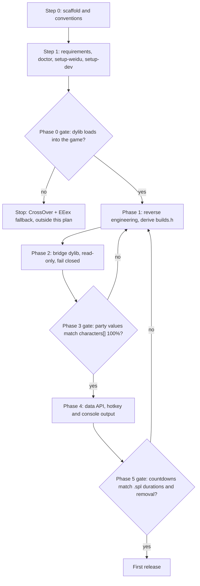
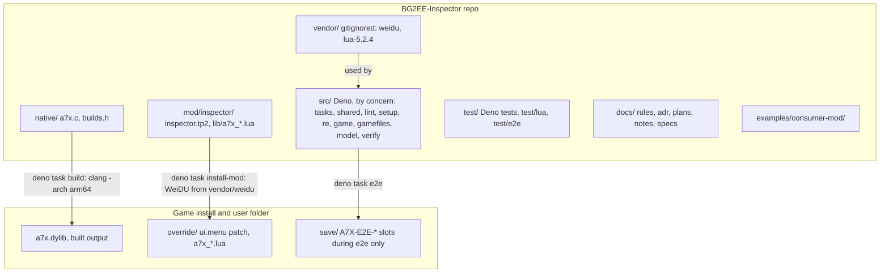
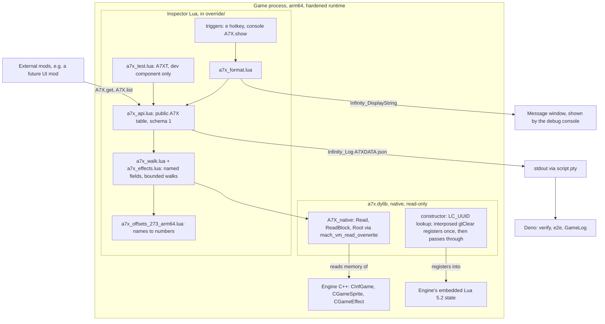
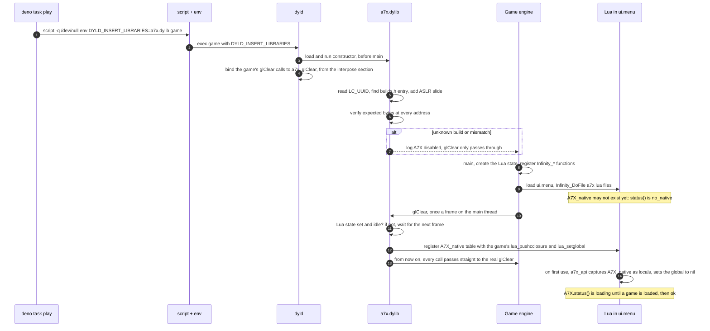
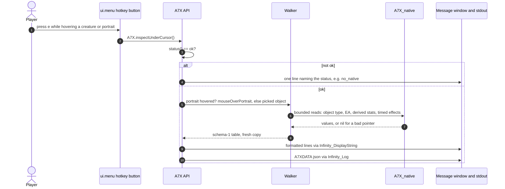
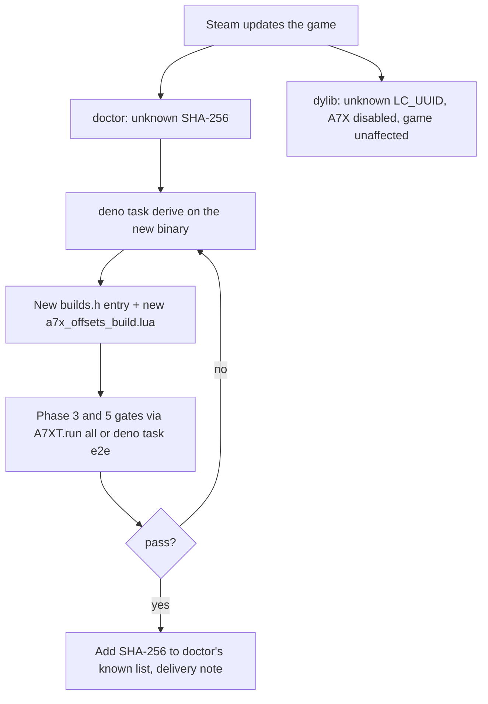

# Architecture

How the inspector is organized, what runs where, and the order things happen in. Each diagram is a
Mermaid block, which GitHub renders and VS Code previews with a Mermaid extension. The decisions behind
these diagrams are in [ADR-0001](adr/0001-native-dylib-injection.md) and
[ADR-0002](adr/0002-read-only-bridge-lua-walker.md). Most of this is still to be built; the
[foundation plan](plans/2026-11-01-inspector-foundation.md) says in which step.

## Roadmap

The steps and phases of the first release. Each diamond is a gate that must pass before work continues.

## Code organization

Where each part of the repo ends up when it is built and installed.

### src layout

`src/` is grouped by concern, and a folder is created only when its first file arrives:

| folder | holds | from |
| --- | --- | --- |
| `src/tasks/` | one thin entry point per `deno task`, each `await runTask(main)` | Step 0 |
| `src/shared/` | `deno_version.ts`, `task.ts` (the runner), `repo_files.ts`; later `config.ts`, `sha256.ts` | Step 0 |
| `src/lint/` | `docs.ts`, `security.ts` | Step 0 |
| `src/setup/` | doctor checks, WeiDU and Lua downloads | Step 1 |
| `src/re/` | Mach-O and arm64 helpers, `derive.ts` for `native/builds.h` | Phase 1 |
| `src/build/` | building and checking the dylib, shared by `build` and `doctor` | Phase 0 |
| `src/game/` | launcher, redaction, WeiDU install, e2e save handling | Phase 0 onward |
| `src/gamefiles/` | `.cre`, `.spl`, `dialog.tlk` readers adapted from BG2EE-GameLog | Phase 3 and 5 |
| `src/model/` | schema-1 types and guard, captured-session parsing | Phase 3 and 4 |
| `src/verify/` | assertions for `deno task verify` and `deno task e2e` | Phase 3 |

The rules, enforced by `test/structure_test.ts`:

- **No loose files** directly in `src/`.
- **Only entry points exit.** `src/tasks/*` and the runner `src/shared/task.ts` are the only code that
  calls `Deno.exit` or reads `Deno.args`, so every library module is safe to import from a test.
- **One way in.** Every task entry point runs through `runTask()`, which checks the Deno version first,
  and every `deno run` task in `deno.json` points at a file in `src/tasks/`.
- **Tests mirror sources:** `test/lint/docs_test.ts` tests `src/lint/docs.ts`.

## Runtime layers

Inside the game process: the engine, its embedded Lua, the read-only native library, and the inspector's
Lua layers. External mods and tools reach only the public API and the JSON output.

## Boot sequence

From `deno task play` to the API being ready, including the fail-closed path for an unknown build.
`script` runs the game in a pseudo-terminal so its output is line-buffered rather than held in 4 KB
blocks.

## Inspect workflow

What happens when the `e` key is pressed over a creature or a portrait. Output happens only on a request
like this; nothing prints automatically.

## Game updates

What happens when Steam patches the game, and how the inspector is brought back.

