# Plan: BG2EE-Inspector foundation, in-game creature stats on macOS

> **Status:** approved 2026-11-01. Step 0 (scaffold and conventions) is recorded in the
> [Step 0 delivery note](../notes/2026-11-01-setup.md), and Step 1 (requirements) in the
> [Step 1 delivery note](../notes/2026-11-01-requirements.md). Decisions are recorded in the
> [ADRs](../adr/README.md), and diagrams also appear in [docs/architecture.md](../architecture.md).
> Edited in place until pushed, per [working-together.md](../rules/working-together.md).

## Context

The goal is an in-game inspector that prints, on demand, for party members, NPCs and enemies:

- real stats: HP, AC, THAC0, saves, resistances, MR
- **active spells, with the time left until each wears off**

Both are in scope for the first release. The second fills the gap BG2EE-GameLog documented: the message log never announces an effect ending ("verified against 61k captured events"). The engine, however, stores each timed effect's expiry time, so reading memory turns that guess into a countdown.

It's in the spirit of BG2RadarOverlay. Those tools rely on EEex, which is Windows-only. It runs on macOS only through CrossOver, against a Windows copy of the game.

The project will be **open-sourced (MIT)** and developed over time. So it starts with:

- written conventions: rules, ADRs, plans, delivery notes, docs, linters and skills, adapted from the tranquil-* projects into a single `docs/` folder with no sibling repos;
- a requirements doc whose installs are the first step.

BG2EE-GameLog has already **settled** that the game's Lua sandbox cannot reach non-party creature state. The full tolua registry has no `CGameSprite`, `CGameArea` or `CGameEffect` classes, and `Infinity_UpdateLuaStats()` covers the party only (`BG2EE-GameLog/docs/FINDINGS.md`, "No creature state is reachable from Lua"). Pure Lua or ui.menu modding therefore can't do this.

**What this session found, and why a native route is viable:**

- **The target is BG2:EE 2.7.3 only, the current Steam release.**
  - **Build:** bundle version `2.7.3` (`CFBundleVersion` 2070300), executable `BaldursGateIIEnhancedEdition`, signed 2026-05-29, SHA-256 `3fa9b60a…e8d8d8`.
  - **Architecture:** a universal binary (arm64 + x86_64), running **natively on arm64** on this Apple Silicon Mac (macOS 14.6.1).
  - **Older versions are out of scope.**
  - **Install state:** clean and unmodded. `WeiDU.log` is empty and `override/` doesn't exist.
- **The game allows injected libraries.** It uses the hardened runtime but ships with the entitlements `com.apple.security.cs.allow-dyld-environment-variables` and `com.apple.security.cs.disable-library-validation`. So `DYLD_INSERT_LIBRARIES` with our own ad-hoc-signed arm64 dylib should load, without re-signing or patching anything on disk.
- **The binary is stripped.** Only Steam and libjingle symbols remain. Lua is linked in statically with no exported names, and the binary identifies it only as "Lua 5.2", with no patch level. Addresses have to be derived by analysing the binary (string references, call targets, data tables). They're then stored in a per-build address table, as EEex (`function_names.db`) and RadarOverlay (hardcoded offsets) do on Windows.
- **Code pages can't be written**, because the hardened runtime forbids it. Inline function hooks are out. Hooks have to swap **data pointers** only. Phase 1 found no `Infinity_*` `luaL_Reg` table to swap an entry in; the hook became dyld interposing of `glClear` ([ADR-0005](../adr/0005-dyld-interposing-hook.md)).
- **An external memory reader can't work.** Under the hardened runtime, `task_for_pid` is denied even to root. Only code inside the game process (the dylib) can read its memory.
- **Struct layouts for this exact version exist.** Bubb13/InfinityLoader contains `EEex-v2.7.3.0` and `LuaBindings-v2.7.3.0`, generated engine struct definitions for 2.7.3 on Windows x64. Field order should match. Offsets need re-checking for LP64 vs LLP64 (`long`), clang vs MSVC layout, and MFC containers.

**Decisions made (2026-11-01):**

- BG2:EE 2.7.3, native arm64, as the only target
- **data first, no UI panel in the first release.** A hotkey or console command prints creature data into the game's message window (the text area the Ctrl+Space debug console opens above itself), through a Lua data API that a UI can be built on later. The panel is a TODO item
- the native dylib written in C
- a new standalone project at **`InfinityEngine/BG2EE-Inspector`** in the development folder, next to `BG2EE-GameLog/` and `IE-setup/`. `InfinityEngine.code-workspace` already lists `"."`, so the new folder appears in VS Code with no workspace edit. Inside the repo, docs refer to it only by relative paths, per the no-personal-info lint
- Lua 5.2 source as a dev requirement; no radare2
- no Java, Ghidra or Homebrew
- one `docs/` folder for all documentation, with no sibling repos
- commits only when explicitly asked
- written rules backed by a committed deny list
- MIT license
- the public repo has issues and pull requests disabled, so there's no CONTRIBUTING file
- no AI attribution anywhere

## Diagrams

These are Mermaid diagrams, which GitHub renders natively and VS Code previews through the installed `bierner.markdown-mermaid` extension (Cmd+Shift+V). In the project they move to `docs/architecture.md` (1–5), `docs/data-model.md` (6–7) and `docs/testing.md` (8–9). `lint:docs` allows `mermaid` as a fence language. Per Tranquil's docs rule, each diagram is rendered and looked at before it's committed: vertical layout, quoted labels, no braces.

### 1. Roadmap: steps, phases and gates

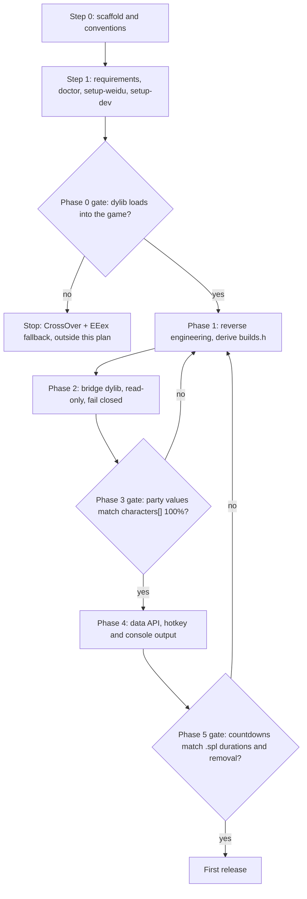

### 2. Code organization: repo to game

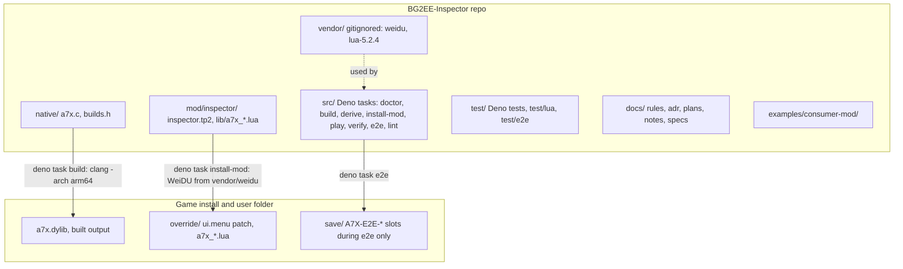

### 3. Runtime architecture: layers inside the game process

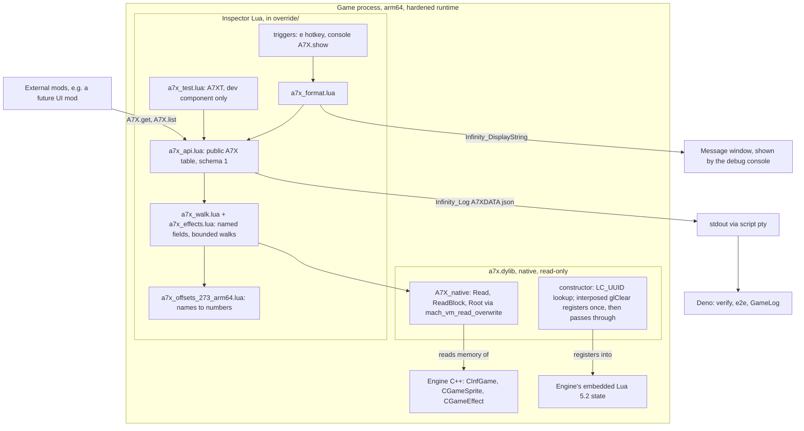

### 4. Boot sequence

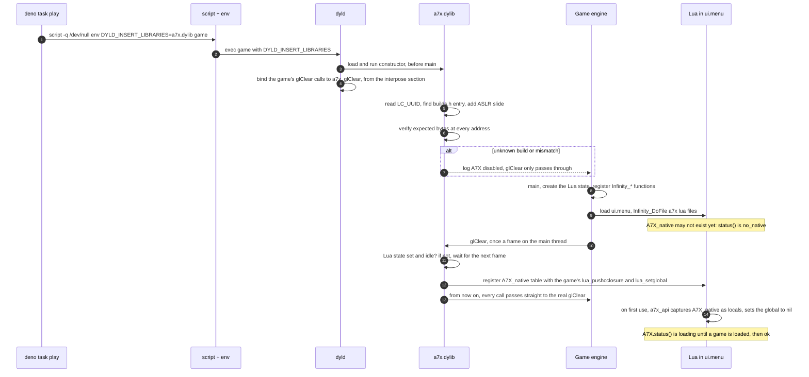

### 5. Inspect workflow: the `e` hotkey

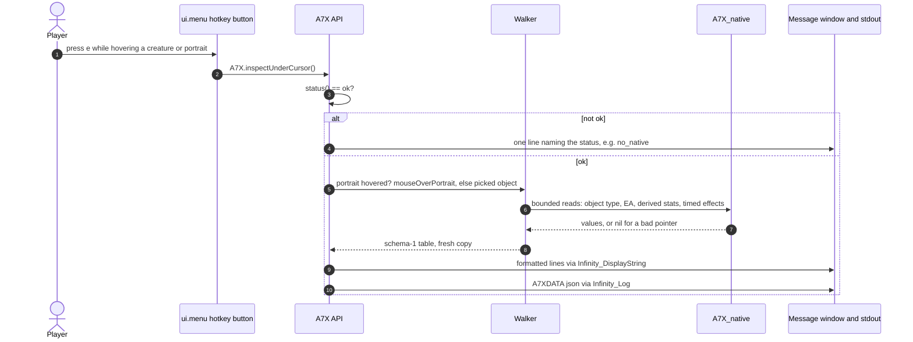

### 6. Engine object graph the walker follows (names from EEex as vocabulary; every offset re-derived on arm64)

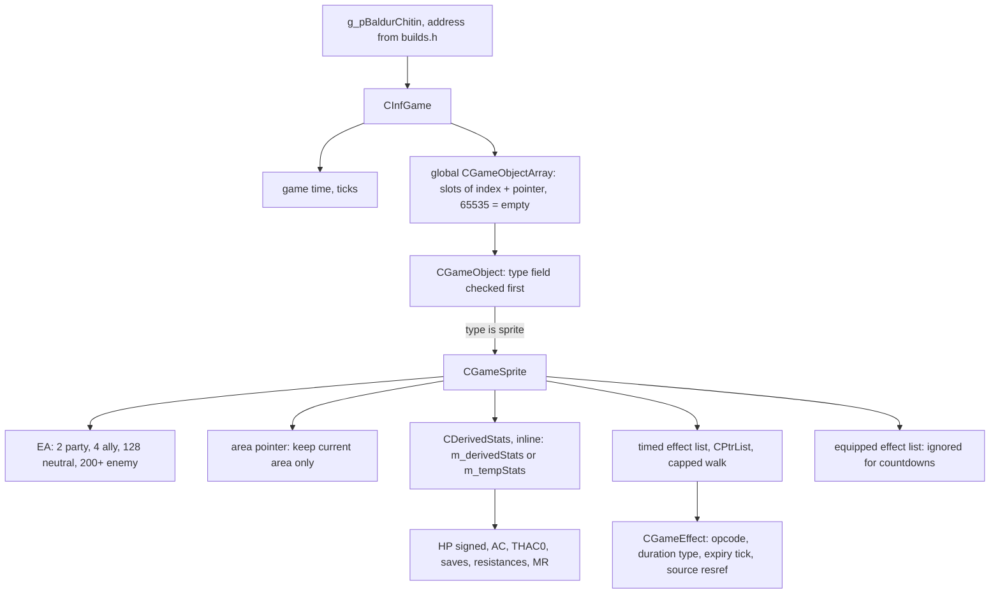

### 7. Data model, schema 1

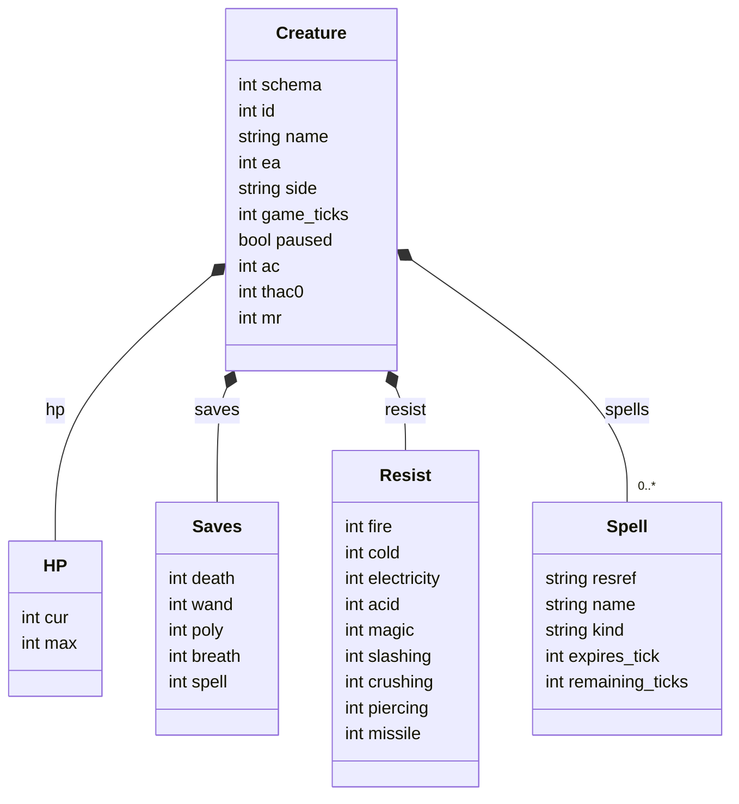

The `A7X.status()` lifecycle a consumer mod sees:

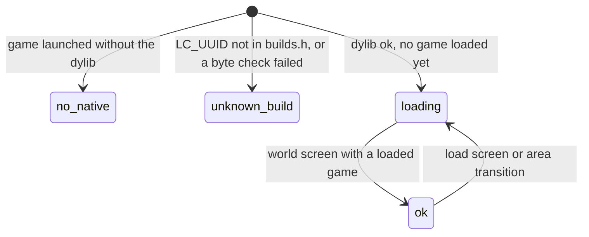

### 8. Validation loop: manual harness and verify

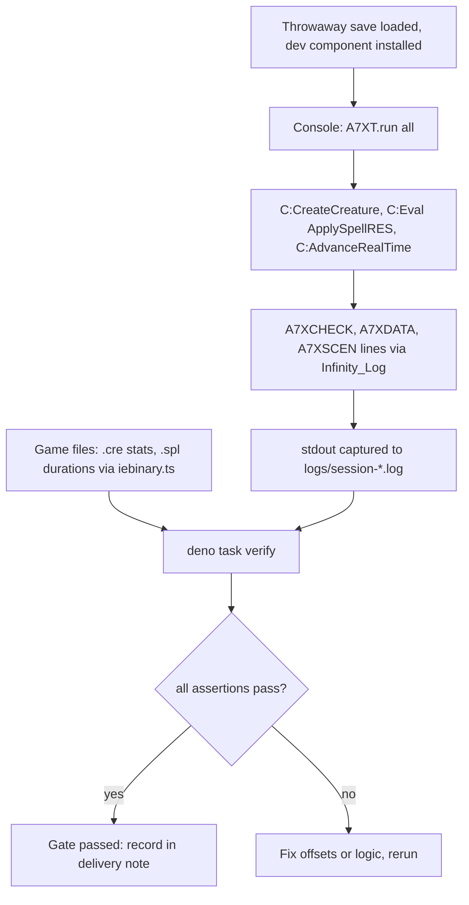

### 9. End-to-end run

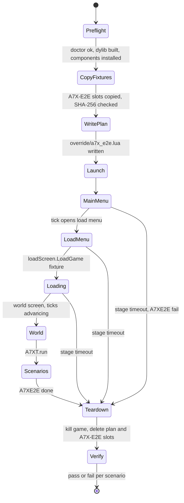

### 10. Game-update workflow

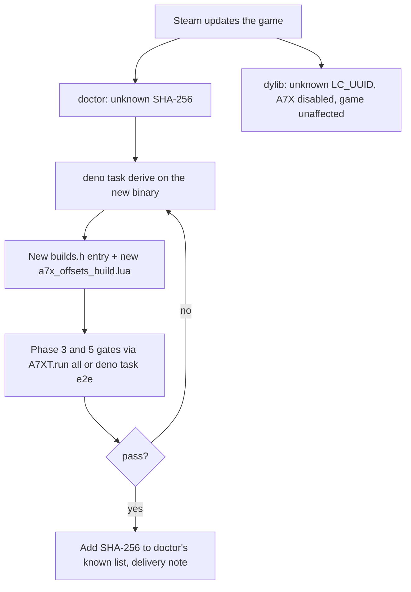

## Step 0: Project scaffold and conventions

This is adapted from the tranquil-* projects (the rules, templates and skill in `tranquil-llm`) and BG2EE-GameLog (its CLAUDE.md, `docs/GOTCHAS.md`, `skills/security.md` and `src/lint.ts`). Tranquil-specific material is dropped: Electron and Pulsar rules, the sibling-repo symlinks, `additionalDirectories`, mdsvex pages and the `docs.ts` registry.

### Layout

```text
BG2EE-Inspector/
  README.md            four short sections (see "README" below)
  LICENSE.md           MIT
  TODO.md              open tasks (see "TODO.md" below)
  CLAUDE.md            agent index: "Always" one-liners + "Read before" table -> docs/rules/*
  AGENTS.md            <= 8-line pointer to CLAUDE.md and docs/README.md
  .claude/
    settings.json      deny + ask lists (below)
    skills/docs-review/SKILL.md (+ references/page-types.md)
    skills/security-audit/SKILL.md
  docs/
    README.md          index of everything in docs/, reading order
    requirements.md    Step 1
    rules/             one rule per file
    adr/               README.md (list), 0000-template.md, NNNN-slug.md
    plans/             YYYY-MM-DD-topic.md
    notes/             YYYY-MM-DD-<topic>.md (delivery notes, dated so they sort by time)
    architecture.md    diagrams 1-5 (roadmap, code organization, runtime layers, boot, inspect)
    re-notes.md, findings.md, gotchas.md, security.md, data-model.md, api.md, testing.md
    manual-tests/      step-by-step manual tests (added at the hook gate, ADR-0004)
  native/              a7x.c, builds.h (per-build address table)
  test/e2e/            fixtures.json (committed); saves/ (gitignored, local fixture saves)
  examples/consumer-mod/  minimal external mod proving the public A7X API (not installed by default)
  mod/inspector/       WeiDU component and in-game Lua
  src/                 grouped by concern, no loose files (see "src layout" below)
  test/                mirrors src/
  vendor/              gitignored downloads
```

### src layout

Decided 2026-11-01, once it was clear a flat `src/` would not hold up. Sources are grouped by concern, and a folder is created only when its first file arrives:

| folder | holds | arrives in |
| --- | --- | --- |
| `src/tasks/` | one thin entry point per `deno task`: `await runTask(main)`, argument parsing, printing | Step 0 |
| `src/shared/` | `deno_version.ts`, `task.ts` (the runner), `repo_files.ts`, later `config.ts`, `sha256.ts` | Step 0 |
| `src/lint/` | `docs.ts`, `security.ts` | Step 0 |
| `src/setup/` | doctor checks, `weidu.ts`, `lua.ts` | Step 1 |
| `src/re/` | `macho.ts`, `arm64.ts`, `derive.ts` (emits `native/builds.h`) | Phase 1 |
| `src/game/` | `play.ts` (pty and DYLD launch), `redact.ts`, `install_mod.ts`, `saves.ts` | Phase 0 onward |
| `src/gamefiles/` | `iebinary.ts`, `resources.ts`, `opcodes.ts`, `protections.ts`, `spellnames.ts`, adapted from GameLog | Phase 3 and 5 |
| `src/model/` | `model.ts` (schema-1 types and guard), `session.ts` (parses `A7X*` lines) | Phase 3 and 4 |
| `src/verify/` | assertions for `deno task verify` and `deno task e2e` | Phase 3 |

Rules, enforced by `test/structure_test.ts`:

- No files directly in `src/`.
- Only `src/tasks/*` and the runner `src/shared/task.ts` may call `Deno.exit` or read `Deno.args`. Every library module is safe to import from a test.
- Every task entry point runs through `runTask()`, which checks the Deno version first.
- Every `deno run` task in `deno.json` points at a file in `src/tasks/`.

`test/` mirrors `src/` (`test/lint/docs_test.ts` tests `src/lint/docs.ts`).

### README

`README.md` has four short sections, in this order. Detail lives in `docs/`, and the README only links to it.

1. **What:** one or two sentences. An in-game inspector for BG2:EE on macOS. Press a hotkey over a creature or portrait, or type a console command, and it prints that creature's stats (HP, AC, THAC0, saves, resistances, MR) and active spells, with time left until each wears off. A screenshot once Phase 5 exists.
2. **Why:** a short paragraph, plus a "why now" sentence.
   - The game shows little of this, and the existing tools (EEex and BG2RadarOverlay) are Windows-only. EEex dropped native macOS support in 2023.
   - **Why it's possible on macOS now:** BG2:EE 2.7 is a **native Apple Silicon (arm64) build**, so the game no longer runs under Rosetta the way earlier versions (x86_64 only, such as 2.6) did. A small native arm64 library can therefore load straight into the game process, with no translation layer in between. That works because Beamdog ships the game with two code-signing entitlements, `allow-dyld-environment-variables` and `disable-library-validation`, that permit loading an extra library.
   - Wording rule for this sentence: it credits both facts, as verified on 2026-11-01. The entitlements were also present in 2.6, so being native isn't stated as the only reason.
3. **Installation:**
   - link `docs/requirements.md` first
   - then `deno task setup-weidu`, `deno task doctor`, `deno task build`, `deno task install-mod`, `deno task play`
   - one line each, plus how to uninstall
   - a note that only the 2.7.3 Steam build is supported, because addresses are binary-specific
   - a note that **compatibility with other mods hasn't been tested yet**, linking the task in `TODO.md`
4. **Attributions and prior art:** a link list, one line each saying what was taken or learned:
   - [EEex](https://github.com/Bubb13/EEex) and [EEex-Docs](https://github.com/Bubb13/EEex-Docs): the `Infinity_*` Lua API reference, and the Lua-centric, per-version-address design this project follows on macOS (reference only; no code used)
   - [EEex forum thread on Beamdog Forums](https://forums.beamdog.com/discussion/71798/mod-eeex-v1-3-1): EEex's history and design reasoning, macOS discussion, and the engine pitfalls (object types, stale pointers after loads, timed versus equipped effect lists, 15 ticks per second) this project's walker guards against
   - [InfinityLoader](https://github.com/Bubb13/InfinityLoader): `EEex-v2.7.3.0` struct and field names, used as a layout guide (reference only; no code or headers used)
   - [BG2RadarOverlay](https://github.com/tapahob/BG2RadarOverlay) (MIT): prior art for showing enemy stats and buff durations from memory reads. Its object-array scan and `CGameEffect` field list were cross-references
   - [Near Infinity](https://github.com/Argent77/NearInfinity) and [IESDP](https://gibberlings3.github.io/iesdp/): file formats and `.cre` and `.spl` fields for checking values
   - [WeiDU](https://github.com/WeiDUorg/weidu): the mod installer
   - [Lua 5.2.4](https://www.lua.org/): the reference build for identifying engine functions; downloaded by `setup-dev`, never redistributed
   - [BG2EE-GameLog](https://github.com/kabootit/BG2EE-GameLog): the launch, capture, WeiDU-patching, game-file-reading and security tooling this project adapts

`lint:docs` checks that the README links resolve. A docs-review pass checks that each section stays short, under about 10 lines.

### TODO.md

`TODO.md` sits at the repo root. It uses the tranquil-test-suite shape:

- a dated intro line
- `##` groups
- `- **Bold lead.** detail` bullets that name the files involved

A task is deleted once it's done, and its outcome goes in the relevant delivery note, so no history is kept. Initial contents:

- **Compatibility with other mods: untested.** So far everything has been tested only on a clean, unmodded 2.7.3 install. Known risks to check:
  - **ui.menu rewrites:** mods that rewrite `ui.menu` (UI mods, iwdification) can remove the inspector's patch, so install order matters, as GameLog already found.
  - **Changed spells:** mods that change spell files (SCS/Stratagems, Ascension, iwdification) change names and effects. The name lookup already reads `override/` first, but the generated `a7x_spellnames.lua` must be regenerated after mod changes.
  - **The GameLog tap:** it should coexist in the same `ui.menu`.
  - **Method:** test with the mods already in this game folder (iwdification, Ascension, Stratagems), then record results in `docs/requirements.md` and a delivery note.
- **UI panel: a separate external mod, not part of this project.** It would be a world-screen `menu` in its own repo, built only on the public `A7X` API (`docs/api.md`) and declared through `REQUIRE_PREDICATE MOD_IS_INSTALLED`. `examples/consumer-mod/` is its starting point.
- **Launching without Deno.** Players of a consumer mod currently need `deno task play` to load the dylib. Two options to test:
  - Steam launch options: `DYLD_INSERT_LIBRARIES=<path> %command%`. It's unknown whether Steam on macOS passes the variable through.
  - A small `.command` launcher.

  Prebuilt, ad-hoc-signed dylib releases would also remove the CLT requirement for players.
- **Clean-machine install: untested.** Confirm that `docs/requirements.md` is complete on a Mac or user account without Xcode or the CLT.

`lint:docs` also checks `TODO.md` and `README.md`: links resolve, no em dashes, no personal info.

### Rules (`docs/rules/*.md`)

Each file has the same shape:

- `# Title`
- the rule in bold
- `**Why:**` with the real incident or reason behind it
- `## How to apply` bullets
- `Related:` links

| file | source | content |
| --- | --- | --- |
| `working-together.md` | Tranquil, adapted | Make the change, say what to test in-game, and wait. Never launch, quit or restart the game unless asked. Stop after two failed fixes or about 20 minutes and report. Test any tool behavior a design depends on before the plan is approved, and record the result in the plan. Edit unpushed docs, plans and ADRs in place, keeping no history. |
| `git.md` | Tranquil, plus GameLog | Run `git add`, `commit` or `push` only when explicitly asked, and show the message first. Creating the GitHub repo or changing remotes needs an explicit go-ahead. Write real messages about what and why. **No AI attribution** (`Co-Authored-By`, "generated with") in commits, code or docs. All work happens on `main`. No branches or pull requests: the public repo has issues and PRs disabled. |
| `writing-style.md` | Tranquil, core only | No em dashes. Impersonal: no personal names, and never "the user asked". Plain and specific. Footnotes (`[^slug]`) for outside sources such as EEex, IESDP and InfinityLoader. Applies to docs, ADRs, notes, plans, commit messages and UI strings. |
| `security-first.md` | Tranquil, plus GameLog's SECURITY invariants | Default-deny. Scoped Deno `--allow-*` flags, never `-A`. Bind loopback only. Redact the Steam id and home paths at capture. The dylib stays read-only (no memory-write API). Ask before running anything not shipped in the repo. Say when a protection is only advisory. |
| `toolchain.md` | GameLog plus Tranquil `deno.md` | Deno for all orchestration. C only in `native/`, Lua only in `mod/`. Never Python, perl, shell scripts, npm or npx. Deno imports limited to pinned `jsr:@std`. **Install nothing without asking**, and every requirement is listed in `docs/requirements.md`. |
| `minimal-surface.md` | Tranquil | Before adding an aid, name who uses it and what breaks without it. Record removed pieces under the ADR's "Options considered". |
| `verify-derived-values.md` | GameLog | Check a derived value against an observable outcome before stating it as fact. Gate unvalidated claims behind one documented constant. For example, struct offsets must match `characters[]`, and countdowns must reach zero when the icon disappears, before enemy values are shown. |
| `tests.md` | Tranquil | Tests in a top-level `test/` that mirrors `src/`. Real-data cases, not throwaway evals. Tests never ship. |
| `docs.md` | Tranquil, adapted to plain markdown | Covers page types, ADR, plan and delivery-note lifecycle, and the "run `lint:docs` first, then the docs-review skill" rule. Fix findings only on the pages being changed. Update reference docs in the same change as the code. |

### ADRs (`docs/adr/`)

- **File and template.** Each ADR is `NNNN-slug.md` (four digits, monotonic) and is listed in `docs/adr/README.md`. `0000-template.md` uses Tranquil's current shape:
  - frontmatter: `type: ADR`, `id`, `title`, `description`, `status` (`proposed | active | superseded | retired`), `date`, and `superseded_by` when superseded
  - the H1 `# ADR-NNNN: Title`, then `**Status:** · **Date:**`
  - sections: `## References`, `## Context`, `## Decision` (bold one or two sentences, then `###` detail), `## Options considered` (`**Option** (chosen)` / `Not taken: … because`), `## Consequences` (including what would trigger re-evaluation)
- **Editing.** Before a push, rewrite in place. After a push, fold in follow-on work; supersede only for a real reversal.
- **Initial ADRs, written in Step 0 from this plan:**
  - `0001-native-dylib-injection.md`: why `DYLD_INSERT_LIBRARIES` on 2.7.3, rather than CrossOver with EEex, an external reader, or Lua only. Includes the EEex history and the claims checked above, as References and Options considered. The forum thread is cited as a footnote: `[^eeex-thread]: [MOD] EEex (v1.3.1), Bubb and contributors, Beamdog Forums, https://forums.beamdog.com/discussion/71798/mod-eeex-v1-3-1`. ADR-0002 (walker pitfalls) and `docs/re-notes.md` cite the same footnote with page numbers.
  - `0002-read-only-bridge-lua-walker.md`: a tiny read-only C surface, data-pointer hooks only, struct walking in Lua, and data-first output (a data API plus message-window text, UI later). Options considered include a UI panel first, and shift-click, which isn't possible.
  - `0003-toolchain.md`: C with the CLT, Deno orchestration, Lua 5.2.4 as a dev reference, and no Java or Homebrew.
  - `0004-project-conventions.md`: one `docs/` folder, the deny list, commit policy, MIT, and what was taken from Tranquil and GameLog (and what wasn't).
  - `0006-data-model.md` (written at Phase 4; number 0005 went to the Phase 1 hook decision, [ADR-0005](../adr/0005-dyld-interposing-hook.md)): Lua tables in-process and JSON lines at the boundary, one versioned spec, an encode-only encoder written in the project. Also the **public API for external mods**: one `A7X` global, semver, `status()` fallbacks, pull-only, private native layer, and the stable tp2 dependency. Options considered for the API: a callback/event registry (deferred), and exposing raw reads to other mods (not taken). Options considered: a vendored JSON library (`rxi/json.lua`, MIT), not taken because of minimal surface and no dependencies; Lua-literal serialization, not taken because Deno can't parse it; JSON everywhere, not taken because of the per-frame encode and decode cost.

### Plans and delivery notes

- **Plans.** Work starts in plan mode. On approval, the plan is saved to `docs/plans/YYYY-MM-DD-topic.md` and edited in place until pushed. Shape:
  - `# Plan: …`
  - `## Context` with "Decisions made (date)"
  - `## Deliverables` (ADR, delivery note, code)
  - the design
  - `## Verification`
  - `## Order of work`, ending with "ask before any commit or remote".
- **Delivery notes.** After each discrete effort (Step 0, Step 1, each Phase), write `docs/notes/YYYY-MM-DD-<topic>.md` (dated like plans so the folder sorts by time; the topic is the summary part of the step's `initial/NN-<summary>` branch, e.g. `2026-11-01-setup.md` for `initial/01-setup`):
  - frontmatter `title` and `description`
  - a `>` lede linking the ADR and the plan
  - `## Status` with a `| Piece | State |` table
  - `## Plan summary`
  - `## What was built` (file tables)
  - `## Gotchas worth remembering`
  - `## Verification`: what was run, with counts, plus a numbered "still to check by hand" list
  - `## Follow-ups`

  It must not claim more verification than actually happened.

### Linters (`deno task lint` runs all of them; any finding fails it)

- **`deno fmt --check`, `deno lint`, `deno check`, `deno test test/`.** Recommended lint rules plus `no-explicit-any`. `compilerOptions.strict`.
- **`deno task lint:docs`** (`src/lint/docs.ts`), the mechanical half of the docs rules:
  - ADRs: frontmatter present and valid, H1 matches the title, ids sequential, each one listed in `docs/adr/README.md`
  - notes and plans: frontmatter present and valid; filenames follow the naming pattern
  - every `docs/` file reachable from `docs/README.md`
  - no dead relative links or anchors
  - every fenced block declares a language
  - **no em dashes**
  - **no personal info** (`/Users/<name>` paths, email addresses)
- **`deno task lint:security`** (`src/lint/security.ts`, ported from GameLog's `src/lint.ts`):
  - every Deno task uses scoped `--allow-*` flags (no `-A`, no bare flags)
  - servers bind `127.0.0.1`
  - imports limited to pinned `jsr:@std`
  - `native/` contains no write primitives (`mach_vm_write`, `vm_write`), and no `mprotect` at all; interposing only for allowlisted functions, through one macro (changed by ADR-0005)
  - `.claude/settings.json` still contains the required deny entries
- **C** builds with `-std=c17 -Wall -Wextra -Werror`.
- **Lua** has no linter, since luacheck would be an install. Its correctness is covered by in-game checks and `A7XCHECK` validation.

### Skills (`.claude/skills/`)

- **`docs-review`**, adapted from tranquil-docs:
  - modes: review, author and lint
  - first run `deno task lint:docs`
  - five passes: purpose and orientation; sequencing (nothing used before it's defined); scanability (a lead-in sentence for every table, h2/h3 only); examples that obey the page's own rules; links
  - severity: broken, friction, polish
  - `references/page-types.md` holds the guide, ADR, plan, delivery-note and rule templates
- **`security-audit`**, adapted from GameLog's `skills/security.md`. It's the judgment half that `lint:security` can't check, extended for the injection surface: what the dylib reads, the DYLD launch path, and the WeiDU patch. Run it before installing the dylib or mod, and before publishing.

### `.claude/settings.json` (committed)

The deny list is a backstop for the written rules, not a sandbox. Claude Code matches deny entries by command prefix, so it's advisory, and `security-first.md` says so.

```json
{
  "permissions": {
    "deny": [
      "Bash(brew install:*)", "Bash(brew upgrade:*)", "Bash(npm:*)", "Bash(npx:*)", "Bash(pip:*)", "Bash(pip3:*)",
      "Bash(python:*)", "Bash(python3:*)", "Bash(curl:*)", "Bash(wget:*)"
    ],
    "ask": [
      "Bash(git add:*)", "Bash(git commit:*)",
      "Bash(git push:*)", "Bash(git remote add:*)", "Bash(git remote set-url:*)", "Bash(gh repo create:*)"
    ]
  }
}
```

`setup-dev` downloads with Deno's `fetch` and a pinned SHA-256, so denying `curl` costs nothing. Push and remote changes are on the ask list rather than denied (decided 2026-11-01), so a push that was explicitly requested can run after a confirmation.

### Branches for this plan

During this plan only, each step and phase is also pushed to `origin` as a marker branch named `initial/NN-<summary>`, and `main` is pushed alongside it. The two-digit number keeps the branches in plan order when listed. Each branch points at the commit that completes its step. This is not a standing rule: after the first release, work simply lands on `main` (see `docs/rules/git.md`).

| step or phase | branch |
| --- | --- |
| Step 0: scaffold and conventions | `initial/01-setup` |
| Step 1: requirements, doctor, setup tasks | `initial/02-requirements` |
| Phase 0: injection smoke test | `initial/03-injection` |
| Phase 1: reverse engineering, address table | `initial/04-reverse-engineering` |
| Hook gate: the interposing probe in the game (ADR-0005) | `initial/05-hook-gate` |
| Phase 2: bridge dylib | `initial/06-bridge` |
| Phase 3: struct walker and harness | `initial/07-walker` |
| Phase 4: data API, hotkey and console output | `initial/08-output` |
| Phase 5: active spells and countdowns | `initial/09-spells` |

The GitHub repo `kabootit/BG2EE-Inspector` starts **private**, with issues and the wiki disabled. `gh` has no flag for disabling pull requests, so that is done in the repository's web settings.

### Step 0 order of work

1. Create `InfinityEngine/BG2EE-Inspector/` and `git init` there, local only. Don't touch `BG2EE-GameLog/`, `IE-setup/` or the workspace file.
2. Write LICENSE, README, TODO.md, CLAUDE.md, AGENTS.md and `.claude/settings.json`.
3. Write `docs/` rules, the ADR template and the four ADRs, and save this plan.
4. Write `lint_docs.ts` and `lint_security.ts`, with tests in `test/`.
5. Write the two skills.
6. Write the delivery note `docs/notes/2026-11-01-setup.md`.
7. When asked: commit, create the private GitHub repo, and push `main` and `initial/01-setup`.

No commit until asked.

## Step 1: Requirements doc, `doctor` check, and installs

Deliverables:

- **`docs/requirements.md`**, linked first from the README's Installation section.
- **`deno task doctor`**, a read-only checker. For each requirement it prints found / missing / wrong version, with the path and version.
- **`deno task setup-weidu`**, which installs WeiDU for players.
- **`deno task setup-dev`**, which fetches the one dev-only download.

### WeiDU: `deno task setup-weidu`

- **Download.** It fetches `WeiDU-Mac-ARM-251.zip` from `https://github.com/WeiDUorg/weidu/releases/download/v251.00/` using Deno's `fetch`. It checks a SHA-256 pinned in `src/shared/config.ts`, and on any mismatch it refuses without unpacking.
- **Unpack.** It unzips with macOS's built-in `ditto -x -k` (`--allow-run=ditto`, nothing else) into gitignored `vendor/weidu/`, then checks that the binary is arm64.
- **Idempotent:** if the pinned version is already present, it does nothing.
- **Finding WeiDU** (`install-mod`, then `doctor`): `$BG2EE_WEIDU` if set (an explicit override, still SHA-checked against the known list, with a warning if unknown), otherwise `vendor/weidu/`.
  - **Change from GameLog:** borrowing a `setup-*` binary from the game folder is dropped. Those are whatever version a mod shipped, often x86_64 (on this machine all three are v249 x86_64, which needs Rosetta), and are matched by filename alone.
- **Facts to establish in Step 1, before the task is written** (per `working-together.md`):
  - **Archive layout:** the path of the `weidu` binary inside the zip.
  - **SHA-256:** the zip's hash, compared against the digest GitHub publishes for the asset if one exists. Otherwise it's recorded as trust-on-first-download, and the requirements doc says so.
  - **Quarantine:** whether a file downloaded by Deno gets `com.apple.quarantine`. Command-line downloads normally don't, but it's checked with `xattr`. If they do, the task strips the attribute and the doc explains why.
- **Manual alternative (documented in `docs/requirements.md`)** for anyone who prefers it:
  1. Download `WeiDU-Mac-ARM-251.zip` from the v251.00 GitHub release.
  2. Check its SHA-256 with `shasum -a 256`.
  3. Unzip it, and clear quarantine if the browser added it: `xattr -d com.apple.quarantine weidu`.
  4. Point `BG2EE_WEIDU` at the binary.

### docs/requirements.md contents

**To play with the mod:**

| requirement | version | how to install | why | doctor checks |
| --- | --- | --- | --- | --- |
| Mac with Apple Silicon | arm64 | none | the dylib and address table target the game's arm64 slice. Intel Macs, which run the x86_64 slice, are unsupported | `uname -m` |
| macOS | tested 14.6.1 (floor unknown) | none | none | `sw_vers` |
| BG2:EE | **2.7.3**, Steam | Steam (the default branch) | addresses are binary-specific; GOG and App Store builds untested (the App Store build is sandboxed and may lack the entitlements) | **SHA-256 of the executable** against the known-good list in `src/config.ts`, plus `CFBundleShortVersionString` and **both entitlements** via `codesign -d --entitlements` |
| Xcode Command Line Tools **or** full Xcode | CLT 16.2 / Xcode with Apple clang 16 (tested) | `xcode-select --install` (CLT, smaller) or Xcode from the App Store | `clang -arch arm64` builds the dylib from source, and the linker ad-hoc signs it. No prebuilt binaries are shipped at first | `xcode-select -p`, then `xcrun -f clang` and `clang --version`. Never trust `/usr/bin/clang`: it's a stub that exists even with nothing installed |
| Deno | **2.9.8 or later** (explicit requirement, checked by `runTask()` in `src/shared/task.ts` at the start of every task, against `MIN_DENO` in `src/shared/deno_version.ts`) | deno.com installer, or `deno upgrade` | build, install and launch tasks | `deno --version` against `MIN_DENO` |
| WeiDU | **v251.00**, native arm64 (`WeiDU-Mac-ARM-251.zip`), pinned SHA-256 | `deno task setup-weidu` (details below) | installs the ui.menu patch | identifies the version **by SHA-256 against a known list, without running the binary**; reports the architecture with `file` |

**Optional:** `Debug Mode = 1` under `Program Options` in `~/Documents/Baldur's Gate II - Enhanced Edition/Baldur.lua`. It enables the Ctrl+Space console for the `A7X.show(...)` commands; the hotkey works without it. Edit the file only while the game is closed, because the game rewrites it on exit. `doctor` reads it and reports the value, without changing it.

**Also needed by contributors** (re-deriving the address table after a game update with `deno task derive`):

| requirement | version | how to install | why |
| --- | --- | --- | --- |
| `llvm-objdump`, `otool` | from the same CLT/Xcode install | nothing extra; present in CLT 16.2's `usr/bin` | arm64 disassembly. Always invoke as `xcrun llvm-objdump`: there's no `/usr/bin/llvm-objdump` stub |
| Lua source | **5.2.4**, pinned SHA-256 | `deno task setup-dev` downloads it from lua.org into `vendor/lua-5.2.4/` (gitignored, never committed or shipped) | (1) compile stock Lua with `clang -arch arm64 -O2` to recognize the game's stripped Lua functions; (2) build the `lua` interpreter used by `deno task test:lua` to unit-test the mod's Lua outside the game. The 2.7.3 binary doesn't record its patch level, so 5.2.4, the final 5.2 release, is the reference |

**Explicitly not required:** Java, Ghidra, Homebrew, radare2, Python, npm.

### On this machine

Present:

- Deno 2.9.8 (upgraded from 2.8.1 on 2026-11-01; 2.9.8 is now the project minimum)
- the game at 2.7.3, with both entitlements confirmed
- Xcode and the CLT (below)

Missing:

- **WeiDU v251 ARM.** The game folder only has WeiDU **v249.00, x86_64** (`weidu`, `setup-ascension` and `setup-iwdification` are byte-identical, SHA-256 `370ff69b…`; version from `SETUP-IWDIFICATION.DEBUG`). It runs only under Rosetta, and the project doesn't use it.
- **Lua 5.2.4 source.**

Both Xcode and the Command Line Tools 16.2 package are installed. The active developer dir is Xcode.

**Toolchain, verified using the CLT only** (with `DEVELOPER_DIR=/Library/Developer/CommandLineTools`, so Xcode was not used):

- **Tools:** `xcrun -f` resolves `clang`, `ld`, `llvm-objdump`, `otool` and `codesign_allocate` inside the CLT folder.
- **SDK:** the CLT carries its own macOS SDK 15.2, which supplies the `mach/mach_vm.h` headers.
- **Build:** a test dylib using the planned APIs (a `constructor` plus `mach_vm_read_overwrite`) compiled and linked for arm64 at `-O2`. Output went to `/dev/null`.
- **Disassembly:** CLT's `llvm-objdump` and `otool` read the game's arm64 slice (`LC_MAIN`, segments).
- **codesign:** `/usr/bin/codesign` is a real binary that ships with base macOS, not a stub.

**Still to verify in Step 1:** that a dylib written to a real file carries an ad-hoc signature (`codesign -dv` shows `Signature=adhoc`).

**Not verifiable here:** a Mac with neither tool installed. The requirements doc says so until someone confirms it.

Step 1 installs exactly two things, both into gitignored `vendor/`:

- `deno task setup-weidu` (WeiDU v251.00 ARM)
- `deno task setup-dev` (Lua 5.2.4 source)

The v249 copies in the game folder are left untouched. Anything found missing later is added to the doc and to doctor, and I ask before installing it.

## Prior-art review: EEex and BG2RadarOverlay (validation and changes)

These are facts read from the projects' repos on 2026-11-01. The EEex forum-thread history is folded in separately below.

| | EEex / InfinityLoader (Windows) | BG2RadarOverlay (Windows) | this plan (macOS) |
| --- | --- | --- | --- |
| Getting into the process | loader exe launches the game and **patches code in memory** (`Hardcoded_WinMainPatchLocation`) | **external process**, `ReadProcessMemory` | `DYLD_INSERT_LIBRARIES` dylib. Code patching and external reads are both blocked by the hardened runtime |
| Locating engine code and data | `loader/v2.7.3.0/bg2ee/function_names.db`: **absolute addresses per exe version** (symbol name per address). Only 7 byte patterns (`pattern_dbs/v2.7.3.0.db`, fixed bytes plus `ADD` offset) for loader bootstrap | **hardcoded module-base offsets per version** (`0x68D438` for 2.6, `0x68F910`/`0x695910` for 2.7) | was: runtime pattern scan. **Changed**, see below |
| Engine Lua state | `LuaPatchMode=INTERNAL` uses the game's own Lua 5.2 state, located by a pattern (`Hardcoded_InternalLuaState`) | not used | the game's own state, reached from an interposed `glClear` (ADR-0005) |
| Struct access from Lua | **generated typed userdata bindings** (`sprite.m_derivedStats`) | raw offset reads in C# | raw reads plus a Lua offsets table (RadarOverlay's model). Typed bindings would mean codegen and a much larger native surface |
| Creature enumeration | engine functions | **scans the global `CGameObjectArray`**: 16-byte slots (index, pointer), `65535` = empty; party has EA `2`, allies `4`, neutrals `128` | was: visible-area object list. **Changed** to the global object array, filtered by area and EA |
| Effects | engine bindings | sprite's timed-effect `CPtrList` (Win x64 `+0x4A00`), separate equipped list (`+0x49B0`); `CGameEffect` duration `+0x20`, duration type `+0x1C`, source resref `+0x8C`; game time `CInfGame+0x3FA0`; list walk capped at 900 nodes | same fields, re-derived on the arm64 binary. **Adopted:** bounded list walks |
| License | **none** (EEex and InfinityLoader). Reference only: nothing copied | **MIT**: offsets and logic may be used as a cross-reference, with attribution | MIT |

**How EEex evolved** (Beamdog forum thread "[MOD] EEex (v1.3.1)", <https://forums.beamdog.com/discussion/71798/mod-eeex-v1-3-1>, all 52 pages; quotes came through a summarising fetch, so recheck any that matter). Every page number cited in this plan refers to this thread. In the project, citations use a `[^eeex-thread]` footnote per `writing-style.md`.

| period | mechanism | stated reason / lesson |
| --- | --- | --- |
| 2018 (p1–p4) | exe patched on disk. Three hardcoded Lua functions to read arbitrary memory (`rdword`, `rstring`), with the logic in Lua | "It's a literal hell to work with the assembly directly". This is the origin of the Lua-centric design, and it's **the same shape as this plan's bridge** |
| 2019 (p9–p18) | EEexLoader: in-memory patching via DLL injection. x86 byte patterns in `EEex.db`. **One bootstrap hook**: the game's `luaL_loadstring` call redirected to register `EEex_Init`. Uses "the EE game executable internal lua which is statically compiled into it" | a single, minimal entry point into the game's own Lua. This plan does the same with one swapped data pointer |
| 2019 (p5, p14) | Beamdog's Windows builds came with **debug symbols (PDBs)**, which gave names and stat offsets | the symbols are what made Windows practical. Today's `function_names.db` is that map |
| 2020–2021 (p33–p36) | v2.6 went 32 to 64-bit: "EEex will have to be rebuilt from the ground up" | raw offsets broke across versions |
| 2023 (p41) | **named-field bindings** replaced raw offsets: "Memory offsets are prone to changing between versions" | code with raw reads "is typically NOT future proof" |
| 2023 (p43–p44) | native macOS **dropped**: "would fight me every step of the way". Wine/CrossOver is recommended instead | macOS is unexplored territory; this plan is that attempt |

**Claims checked against the 2.7.3 macOS binary:**

- **Refuted: "Unix binaries can never be fully stripped", so use `dlsym`/DWARF instead of patterns** (p29, 2020). The 2.7.3 arm64 binary keeps 719 symbols, all Steam and libjingle, with no engine or Lua names. That route is closed for this build. It may have held for older macOS builds.
- **Refuted: ASLR makes fixed offsets "pretty much impossible"** (p29). An in-process dylib reads the slide directly (`_dyld_get_image_vmaddr_slide`), so image-relative offsets work.
- **Confirmed: a macOS loader needs the five steps fearless listed** (p18): get in, locate functions and globals, hook a Lua entry point, allocate, run init code. This plan covers them with DYLD, the address table, an interposed `glClear` (ADR-0005), no allocation, and a constructor.

**What this validates:**

- **Read-only, in-process access is the established model.** RadarOverlay shows stats and buff durations from plain memory reads, with no engine calls. That's the scope of this project.
- **Per-version fixed addresses, not general pattern scanning.** Both mature tools work this way. Patterns are a tool for re-deriving addresses after an update, not something to run at every launch.
- **Lua as the logic layer** (EEex: "most of its functionality implemented as Lua code") with a small native core.

**What changes in this plan:**

1. **An address table keyed by build instead of a runtime pattern scan.**
   - `native/builds.h` maps each supported build's **`LC_UUID`** (read for free from the in-memory Mach-O header via `_dyld_get_image_header(0)`) to image-relative offsets: the `lua_State*` global, the Lua API functions, and `g_pBaldurChitin`. The ASLR slide is added at load.
   - Each address is checked at load against a few expected bytes. An unknown UUID or any mismatch means `A7X disabled` and nothing registered.
   - `src/re/macho.ts` and pattern searching move to dev tooling (`deno task derive`), which re-derives the table after a game update.
   - `doctor` still pins the SHA-256.
2. **Enumerate creatures through the global `CGameObjectArray`** (RadarOverlay's method), filtered by area and EA, instead of locating per-area lists.
3. **Bounded walks:** every list or array walk in Lua has a node cap and a pointer-range check, on top of the `mach_vm_read_overwrite` safety.
4. **Windows offsets as starting hints only.** RadarOverlay's MIT offsets (and EEex's field names, used as reference) are a guide to where to look. Every offset used is re-derived and validated on the macOS arm64 binary (Phase 3 and 5 gates), because LP64/clang layout and Beamdog's macOS build may differ.
5. **Field names in walker code, numbers only in the offsets file.** This is EEex's lesson (p41) without its codegen. `a7x_walk.lua` reads through named paths, for example `R(sprite, "CGameSprite.m_derivedStats.m_nHitPoints")`, and only `a7x_offsets_<build>.lua` maps names to numbers and types. A new build means a new offsets file, not edits throughout the walker. EEex's field names are used as the vocabulary: names are reference facts, not copied code.
6. **Engine pitfalls the thread documents, built into the walker:**
   - **Check the object type** (every game object has a type field, p20) before treating it as a sprite. Reading stats off non-sprite objects crashed EEex.
   - **Don't walk during loads or area transitions.** Stale and null area pointers just after a load caused repeated EEex crash fixes (p19, p21, p25, p31). Combined with GameLog's gotcha 1, the walker runs only on the world screen with a loaded game, and skips a frame when any pointer fails a range check.
   - **Choose the right stats block.** `CDerivedStats` is inline in `CGameSprite` (p5). EEex reads `m_derivedStats` only when `m_bAllowEffectListCall ~= 0`, and `m_tempStats` otherwise (from `EEex_Sprite.lua`). Adopt the same rule, and validate it in Phase 3.
   - **Read HP as signed** (p15).
   - **Effects come in two lists**, timed and equipped (p19–21). Only the timed list feeds countdowns.
   - **Durations are in ticks at "15 ticks per second"** (p19–21). The constant still goes through the Phase 5 gate.
   - **Timing modes are irregular** (p11, p13, p17), and Time Stop runs about twice its stated duration (p12). The output shows the engine's actual expiry, never a duration computed from the spell file.
   - **Values are briefly wrong while paused** (p26): adding an effect during pause resolves all effects at once. Show the last stable value while paused, or accept and document the flicker.
7. **Performance budget.** Lua-side effect handling caused stutter in EEex (p43, p48). So walks are throttled (about every 15 frames), capped, and timed with `Infinity_GetClockTicks` around each refresh. If one refresh exceeds a small per-frame budget (for example 2 ms) with a full arena fight on screen, the effect walk moves into C as a read-only `A7X_ReadEffects(sprite)`, still with no write path.
8. **A licensing rule** (added to `security-first.md` and ADR-0004):
   - Code, headers and `.db` files from EEex and InfinityLoader are never copied, vendored or generated from: they have no license.
   - Offsets are re-derived independently, and the sources credited.
   - MIT sources such as RadarOverlay may be adapted with attribution.

## Architecture

```text
deno task play
  -> /usr/bin/script -q /dev/null       (runs the game in a pseudo-terminal so stdout is line-buffered)
  -> /usr/bin/env DYLD_INSERT_LIBRARIES=a7x.dylib
  -> game process (arm64)
                                                             |- a7x.dylib  (C, arm64, read-only bridge)
                                                             |    ctor: LC_UUID -> address table, verify bytes, fail closed,
                                                             |    interposed glClear: once Lua is idle on the main thread,
                                                             |    register A7X_* Lua fns, then pass every call through
                                                             '- Lua (override/*.lua, via ui.menu patch)
                                                                  struct + effect walker, offsets table
                                                                  -> data API (A7X.get / A7X.list -> Lua tables)
                                                                  -> formatter -> Infinity_DisplayString
                                                                     (message window; triggers: hotkey, console)
```

The native surface is deliberately tiny and **read-only**. All struct walking lives in Lua, so offsets can be iterated with `Infinity_DoFile` reloads instead of recompiling, and no write API exists that could corrupt a save.

Native API, registered into a temporary `A7X_native` global. `a7x_api.lua` captures it as private locals, then sets the global to `nil`, so other mods never see raw reads (see "Integration contract"):

- `A7X_Version()`
- `A7X_Root()`: address of `g_pBaldurChitin` (the object behind Lua's `e`)
- `A7X_Read(addr, kind)`: kind is `u8/i8/u16/i16/u32/i32/ptr/cstr`
- `A7X_ReadBlock(addr, len)`

Every read goes through `mach_vm_read_overwrite(mach_task_self(), ...)`, so a bad pointer returns `nil` instead of segfaulting the game.

Patterns, offsets and doctor's known-good list are all keyed to the executable's SHA-256, with one `a7x_offsets_<build>.lua` per build. A Steam update to 2.7.x therefore fails closed and is flagged, instead of reading wrong addresses.

## Phases (each one ends at a gate and gets its own delivery note)

### Phase 0: Injection smoke test (gate: is the whole idea viable?)

- `native/a7x.c` contains only a `__attribute__((constructor))` that writes `A7X loaded` to stderr. `deno task build` runs `clang -arch arm64 -dynamiclib`.
- Launch the way GameLog does: `script -q /dev/null /usr/bin/env DYLD_INSERT_LIBRARIES=<dylib> <GAME_BINARY>`.
  - `/usr/bin/script` runs the game inside a pseudo-terminal (pty). Otherwise its stdout goes to a pipe and is block-buffered in 4 KB chunks, so log lines (the `A7X loaded` marker, `A7XCHECK` validation lines) arrive late and in bursts (GameLog gotcha 12).
  - `-q /dev/null` suppresses `script`'s banner and transcript file. **Risk:** `script` is SIP-protected, and dyld strips `DYLD_*` variables from protected processes. Setting the variable through `env` inside `script`'s argv should avoid that. Verify it.
- Pass: the marker appears on stdout and the game plays normally. Fallback to try: launch with `Deno.Command` plus `env` directly, without the pty.

### Phase 1: Static reverse engineering (arm64 slice)

Tools:

- **`xcrun llvm-objdump --arch=arm64 -d --start-address/--stop-address`** disassembles small address ranges.
- **`src/re/macho.ts`**, a Deno helper. It reads the arm64 slice's segments and sections, finds C strings and the pointers to them, resolves `ADRP`+`ADD`/`LDR` pairs into data addresses, and lists `BL` call targets. Real-data tests go in `test/macho_test.ts`.
- **`vendor/lua-5.2.4/`**, compiled with `clang -arch arm64 -O2` as a reference. The patch level and compiler flags may differ from the game's, so functions are confirmed by behavior, not byte-identity.
- `lldb` can't attach (hardened runtime, no `get-task-allow`). Runtime facts come from the dylib's own logging.

Record everything in `docs/re-notes.md`: address, the expected bytes used for the load-time check, how it was found, and how it was verified. `deno task derive` (built on `src/macho.ts`) prints the `native/builds.h` entry for a binary, so the table is regenerated, not hand-edited, after a game update.

1. **The `Infinity_*` `luaL_Reg` array:** scan for pointers to the `"Infinity_Log"` string. Done: there is no such array; the functions are registered in code, and the hook changed to dyld interposing ([ADR-0005](../adr/0005-dyld-interposing-hook.md)).
2. **The Lua C API** (`lua_pushcclosure`, `lua_setglobal`, `lua_tolstring`, `lua_pushnumber`, `lua_pushinteger`, `lua_pushlstring`, `lua_pushnil`, `luaL_checkinteger`/`checklstring`): follow the call targets out of known `Infinity_*` implementations and the error-string references. Confirm each one against the stock 5.2.4 build.
3. **`g_pBaldurChitin`:** find it through the compiled-in tolua bootstrap that binds `e`.
4. **The struct chain**, from InfinityLoader's `EEex-v2.7.3.0` headers (read on GitHub; nothing executed): `CBaldurChitin -> CInfGame -> global CGameObjectArray -> CGameSprite -> CDerivedStats`, plus the sprite's area pointer (for filtering) and:
   - EA
   - the timed-effect list (`CGameEffect`: opcode, duration type, expiry, source resref)
   - the current game time in `CInfGame`
   - the world screen's pause state, for the `paused` flag
   - the area's picked-object field (the creature under the cursor), for the hotkey

   Note every field whose type differs between Windows LLP64/MSVC and macOS LP64/clang.

### Phase 2: The bridge dylib

- **Fail closed on the address table.** `native/builds.h` maps the 2.7.3 build's `LC_UUID` to image-relative offsets. At load the dylib:
  1. reads `LC_UUID` from `_dyld_get_image_header(0)`;
  2. looks up the entry and adds the ASLR slide (`_dyld_get_image_vmaddr_slide(0)`);
  3. checks the expected bytes at every address.

  On an unknown UUID or any mismatch it registers nothing and logs `A7X disabled: <reason>`; it never crashes.
- **Hook by dyld interposing** ([ADR-0005](../adr/0005-dyld-interposing-hook.md), replacing the planned `luaL_Reg` swap, which Phase 1 showed impossible). The library interposes `glClear`. Once the probe passes the hook gate, the replacement registers the `A7X_*` functions with the game's own `lua_pushcclosure` and `lua_setglobal` on the first main-thread call with Lua idle, and otherwise passes every call through.
- **Respect GameLog's gotcha 1:** no engine accessor runs at UI-load time.

### Phase 3: Lua struct walker plus ground-truth validation (gate before showing enemy data)

- `mod/inspector/lib/a7x_offsets_273_arm64.lua` holds the offsets table. `a7x_walk.lua` enumerates creatures by scanning the global `CGameObjectArray`, keeping sprites in the current area. Every walk is bounded by a node cap and pointer-range checks. For each creature it reads name, HP/max, AC, THAC0, saves, resistances, MR and EA.
- **Validation:** emit `A7XCHECK` lines comparing walker values against party `characters[id]` through `Infinity_Log`. A Deno test asserts 100% agreement before enemy values are shown.

### Developer test harness (introduced in Phase 3, extended in Phase 5)

The Phase 3 and 5 gates need repeatable game situations: a known creature, a known spell, and time passing. The stock engine already exposes a console object to Lua, `CLUAConsole` (the `C` global used by the stock `cheatMenu`: `C:AddGold`, `C:MoveToArea`). Its 2.7.3 method list, read from the binary, includes:

- `Eval` and `Exec`
- `CreateCreature`, `CreateItem` and `AddSpell`
- `AdvanceRealTime`
- `SetGlobal` and `GetGlobal`
- `DisplayText` and `LogMessages`

`C:Eval("<script action>")` runs a game-script action, such as `ApplySpellRES("SPWI212",Player1)`.

- **Not needed: Lua called from game scripts.** That's the other direction, shown in Bubb's 2018 post (comment 998033), and it needs EEex's patched executable. Driving script actions from Lua through `C:Eval` covers testing.
- **A separate, opt-in WeiDU component**, "Developer test commands", that's never installed by default. It adds `override/a7x_test.lua`, which defines console commands under `A7XT`:

| command | does | emits |
| --- | --- | --- |
| `A7XT.check()` | compares `A7X.get` for each party member against `characters[id]` | `A7XCHECK` lines, the Phase 3 gate |
| `A7XT.spawn(cre)` | `C:CreateCreature(cre)` next to the party, using fixtures whose `.cre` values are known | an `A7XDATA` record for the spawned creature |
| `A7XT.buff(spl, who)` | `C:Eval('ApplySpellRES("<spl>",<who>)')` | a before and after `A7XDATA` pair |
| `A7XT.advance(ticks)` | `C:AdvanceRealTime(…)` to step game time | `remaining_ticks` before and after |
| `A7XT.scenario(name)` | a scripted sequence, e.g. `"blur"`: apply Blur to Player1, snapshot, advance, snapshot, then poll until the effect is gone | `A7XSCEN` start, step and end lines |
| `A7XT.run("all")` | every scenario, in order | a summary line in the message window |

- **The Deno side checks the results:** `deno task verify <session-log>` computes the expected values from the game files.
  - **Expected values:** `.cre` stats and `.spl` durations come from the readers adapted from GameLog (`iebinary.ts`, `resources.ts`).
  - **Assertions:** the spawned creature matches its `.cre` file. Blur's first `remaining_ticks` equals its `.spl` duration × ticks per second, within one refresh. An advance of N ticks reduces `remaining_ticks` by N. The effect disappears when `remaining_ticks` reaches 0.

  This is how the 15-ticks-per-second constant gets validated instead of assumed. It turns most of the hand-run Phase 3 and 5 checks into: open the console, type `A7XT.run("all")`, then run `deno task verify`.
- **Facts to establish before building on them** (per `working-together.md`), each tested in the console and recorded in `docs/re-notes.md`:
  - **`C` availability:** whether `C` exists outside the Ctrl+Space console and whether it needs `Debug Mode = 1`.
  - **`AdvanceRealTime`:** its argument unit (ticks or seconds) and whether it advances effect timers.
  - **`C:Eval` targeting:** which object names (`Player1`, `LastSummonerOf`) resolve from the console.
  - **`CreateCreature` placement:** where the creature appears.
- **State safety:**
  - The harness changes game state (spawning, spells, time), so the docs say to use a throwaway save. Every command first prints a one-line warning to the message window.
  - It uses only the engine's own console API. The dylib stays read-only, and `lint:security`'s no-write-primitive check is unaffected.
  - The harness component is excluded from the default install, and `install-mod` doesn't offer it unless run with `--dev`.
- **End-to-end runs on the real game, starting from save files: `deno task e2e <suite>`.** The harness above is the in-game half. The stock UI provides the rest: `loadScreen:LoadGame(fileName)` is a Lua-callable engine method (the stock load screen calls it on double-click, with `gameSaves.files[i].fileName`), so a save can be loaded with no clicks.
  1. **Preflight:** `doctor` passes, the dylib is built, and the inspector and dev components are installed.
  2. **Fixtures in place:** copy fixture saves from gitignored `test/e2e/saves/` into the game's save folder as `A7X-E2E-<name>` slots. It never touches any other slot, and refuses if a non-fixture slot already has that name. Each save's SHA-256 is checked against `test/e2e/fixtures.json`.
  3. **Write a run plan:** generate `override/a7x_e2e.lua` with the run id, fixture name and scenario list. It exists only for the run's duration.
  4. **Launch** through the same `script` plus `DYLD_INSERT_LIBRARIES` path as `play`, capturing stdout.
  5. **In-game state machine** in `a7x_test.lua`'s per-frame tick, active only when the plan file loaded:
     1. main menu, then open the load menu
     2. wait for `gameSaves` to populate
     3. `loadScreen:LoadGame(<fixture>)`
     4. wait for the world screen with game ticks advancing
     5. `A7XT.run(<scenarios>)`
     6. emit `A7XE2E done <run id>`

     Each stage has a timeout and emits `A7XE2E fail <stage>` on expiry.
  6. **Teardown:** on `done`, `fail` or an overall timeout, Deno terminates the game process, deletes the plan file and removes the `A7X-E2E-*` slots it copied in. The game is never saved during a run.
  7. **Assert:** feed the captured session to `deno task verify` (the same assertions as the manual path), and print pass or fail per scenario.
- **Fixture saves are local only, never committed.** Saves embed game-derived data and the party's names and portraits, and the repo is public.
  - `docs/testing.md` gives a recipe for each fixture, for example `quiet-party`: a 6-member party at full health with no active buffs, saved in a safe area. Scenarios spawn their own opponents with `C:CreateCreature`, so fixtures stay simple.
  - `test/e2e/fixtures.json` (committed) records each fixture's name, recipe link and the local SHA-256. That makes runs reproducible on one machine, and a changed save gets noticed.
- **Facts to establish before building the e2e runner** (tested by hand first, results in `re-notes.md`):
  - **Driving the load screen from a tick:** whether `loadScreen:LoadGame` works when called from a per-frame tick on the main menu, and whether `gameSaves` needs the load menu pushed first.
  - **Missing plan file:** whether `Infinity_DoFile` on a file that doesn't exist raises a catchable Lua error. If not, a stub `a7x_e2e.lua` is always installed and the runner overwrites it.
  - **Process termination:** that ending the game process leaves no stale lock or half-written settings. `Baldur.lua` is rewritten on exit, so `doctor` compares it before and after.
- **Scope:**
  - Local and macOS only. It needs the game and a GUI session, so there's no CI.
  - Launching the game is an explicit, human-invoked action. Under `working-together.md`, Claude runs `deno task e2e` only when asked, and says beforehand that the game window will open.
- **The manual checklist** lives in `docs/manual-tests/` (changed from `docs/testing.md` at the hook gate, ADR-0004), one page per test: the save to use, the console steps and the expected output. Each delivery note's "still to check by hand" list points there.

### Phase 4: In-game output (hotkey and console; no UI panel)

The data is useful without a UI and stays reusable by one later. What the stock 2.7.3 `ui.menu` offers was checked read-only in `data/Patch2.bif`.

**Data architecture** (ADR-0006, `docs/data-model.md`):

Lua has no built-in JSON; its native data structure is the table. So:

- **Inside the game, plain Lua tables.** A future in-game UI reads the same tables the formatter does, with no encode or decode step in a per-frame path.
- **At the boundary, JSON.** Any consumer outside the Lua VM (Deno tests, GameLog, a future external viewer) gets JSON lines, which Deno parses natively.

Both use **one model**, defined once and versioned:

| piece | file | role |
| --- | --- | --- |
| **Specification** | `docs/data-model.md` | Every field with its type, **unit** (engine units such as ticks; formatting is never baked into the data), the engine field it comes from, and its **validation status**. A field whose gate hasn't passed is omitted, never guessed (per `verify-derived-values.md`). |
| **Type definition** | `src/model/model.ts` | TypeScript types plus one hand-written parse guard. Untrusted JSON gets its type at this single boundary (Tranquil `types.md`), with no `any`. |
| **Lua producer** | `mod/inspector/lib/a7x_api.lua` | Builds tables in exactly the documented shape, with snake_case keys and `schema = 1` on every record. |
| **Encoder** | `mod/inspector/lib/a7x_json.lua` | A minimal **encode-only** JSON writer (about 60 lines), written in this project rather than vendored, so no new dependency. Keys are sorted for deterministic output. `nil` fields are left out. Integers are kept as integers. Strings are escaped per RFC 8259. |
| **Transport** | `Infinity_Log("A7XDATA\t" .. json)` | Goes to stdout, then the existing pty capture, then Deno. This is the same channel and prefix-marker idea GameLog uses for `A7LOG`, `A7ROSTER` and `A7STATS`. Lines are emitted on each inspect, plus in validation runs. |
| **Contract test** | `test/model_test.ts` | Parses every `A7XDATA` line from a captured session through the guard, and fails on unknown, missing or mistyped fields. This is what keeps the Lua side and the spec in step. |

**Record shape, schema 1** (field list in `data-model.md`; outline here):

```json
{
  "schema": 1,
  "id": 1234,
  "name": "Fire Giant",
  "ea": 255,
  "side": "enemy",
  "game_ticks": 512340,
  "paused": false,
  "hp": { "cur": 112, "max": 140 },
  "ac": -1,
  "thac0": 4,
  "mr": 0,
  "saves": { "death": 3, "wand": 5, "poly": 4, "breath": 4, "spell": 6 },
  "resist": { "fire": 100, "cold": 0, "electricity": 0, "acid": 0, "magic": 0, "slashing": 0, "crushing": 0, "piercing": 0, "missile": 0 },
  "spells": [
    { "resref": "SPWI408", "name": "Stoneskin", "kind": "timed", "expires_tick": 516120, "remaining_ticks": 3780 }
  ]
}
```

- `side` is derived from `ea` by one documented mapping (party `2`, ally `4`, neutral `128`, enemy `≥ 200`).
- `remaining_ticks` is `expires_tick − game_ticks`. Both raw values are kept, so a consumer can recompute it after the record was taken.
- `kind` is `"timed"` or `"until_dispelled"`.

**Versioning:**

- Adding an optional field keeps `schema = 1`.
- Renaming, removing or changing a field's meaning bumps `schema`, and updates the spec, the guard and an ADR in the same change.

**Testing Lua outside the game:** `deno task test:lua` builds a stock `lua` interpreter from the `vendor/lua-5.2.4/` source (a contributor requirement already, compiled with the CLT `clang`). It runs `test/lua/*_test.lua` against the encoder, the formatter, and the walker fed a fake memory map. The Lua code otherwise has no linter, and this gives it unit tests with nothing new installed. `docs/requirements.md` notes that the contributor Lua source is now used for this too.

**Integration contract for other mods** (`docs/api.md`, part of ADR-0006):

A UI, or any other consumer, is a **separate mod** in its own repo with its own WeiDU installer. It depends on this project only through a published, read-only Lua API.

| concern | contract |
| --- | --- |
| **Public surface** | One global table, `A7X`, with these functions: `A7X.version()`, `A7X.status()`, `A7X.get(id)`, `A7X.list(filter)`, `A7X.hovered()`, `A7X.portrait()`. Nothing else is public. Formatters, triggers and offsets are internal. |
| **Native layer stays private** | The dylib registers its read functions into one temporary global. `a7x_api.lua` captures them as local upvalues at load, then sets that global to `nil`. Other mods therefore can't make raw memory reads (stability and safety), and can't come to depend on offsets that change per build. |
| **Versioning** | `A7X.version()` returns `{ api = "1.0", schema = 1, build = "<LC_UUID>" }`. API changes follow semver: adding a function is minor, changing or removing one is major. Records carry `schema` (above). A consumer checks `api` major before calling anything. |
| **Availability** | `A7X.status()` returns `"ok"`, `"no_native"` (the game wasn't launched with the dylib), `"unknown_build"` (UUID not in the table) or `"loading"` (no game loaded, or a screen transition). Every data call returns `nil, status` when not `"ok"`. A consumer shows its own fallback and never crashes because the inspector is missing. |
| **Load order** | Both mods patch `ui.menu`, in either order. A consumer looks `A7X` up when it needs it (`if A7X and A7X.status() == "ok"`), never at file load, so it works whichever `Infinity_DoFile` ran first. |
| **Pull, not push** | Consumers call the API from their own throttled `text lua` tick. No callback registry in v1, so a consumer error can't break the inspector. An event API could be a later minor version if a real consumer needs one. |
| **No shared mutable state** | Every call returns **fresh tables**, so consumers can't mutate inspector state. A per-refresh snapshot cache sits behind the API, so polling consumers don't cause repeated memory walks. |
| **Install-time dependency** | The consumer's `.tp2` declares `REQUIRE_PREDICATE MOD_IS_INSTALLED ~inspector/inspector.tp2~ ~0~`. The tp2 path and component number are part of the contract and documented as stable. |
| **Outside the game** | Tools that aren't game mods (external viewers, GameLog) read `A7XDATA` JSON lines from the captured stdout (above). Same schema, no Lua required. |

**Proving the contract from this repo** without shipping a UI: `examples/consumer-mod/` is a minimal external mod (a tp2 plus about 30 lines of Lua). It requires the inspector and prints `"<n> enemies, nearest <name> <hp>"` through `A7X.list` and `A7X.get`, and it shows the `no_native` fallback. It isn't installed by `install-mod`; it exists to test and document the integration path.

**Layers:**

1. **Data API** (`a7x_api.lua`): this is the contract a future UI builds on. Every function returns schema-1 tables.
   - `A7X.get(id)` returns a plain table: name, EA, HP/max, AC, THAC0, saves, resistances, MR, and `spells = { {name, resref, remaining_ticks, kind}, ... }`.
   - `A7X.list(filter)` returns ids and names for creatures in the current area. Filters: `"enemies"`, `"party"`, `"all"`.
   - `A7X.hovered()` returns the creature under the cursor: the area's picked-object field, found in Phase 1. EEex-v2.7.3.0's `CGameArea` names it, re-derived on arm64.
   - `A7X.portrait()` returns the creature behind a hovered portrait, using the stock `mouseOverPortrait` global that `ui.menu` already maintains (`actionEnter "mouseOverPortrait = N"`).
2. **Formatter** (`a7x_format.lua`): turns a table into compact text.
   - One header line: `[A7X] Fire Giant  HP 112/140  AC -1  THAC0 4  MR 0%`.
   - One line for saves and resistances.
   - One line per active spell: `Stoneskin 4m 12s`.
   - A verbose form adds every field.
   - Colored with the engine's `^0xAARRGGBB…^-` markup (from GameLog's findings).
3. **Output** through `Infinity_DisplayString`, which writes into the message window.
   - This is the same text area the Ctrl+Space debug console opens: the stock `cheatConsole` menu calls `Infinity_PushMenu('WORLD_MESSAGES')` in its `onOpen`. So the output is "in the debug console" when it's open, and still visible in normal play when it isn't.
   - Bonus: GameLog's tap captures the message window, so every `[A7X]` line also reaches GameLog's database and viewer with no extra transport. GameLog should treat the `[A7X]` prefix as its own kind; noted for GameLog, out of scope here.

**Triggers:**

| trigger | how | needs | status |
| --- | --- | --- | --- |
| **Hotkey over a creature or portrait** | an invisible `button { on 'e' action "A7X.inspectUnderCursor()" }` patched into a world-screen menu. Stock `ui.menu` already binds character keys this way (`on '8'` on the character-creation screen). Inspects the portrait if one is hovered, otherwise the creature under the cursor | nothing extra | **To test first.** The world screen may handle the key before `ui.menu` does. Record the result in the delivery note |
| **Console commands** | in the Ctrl+Space console: `A7X.show()` (the hovered or selected creature), `A7X.show("enemies")`, `A7X.show("party")`, `A7X.show(id)` | `Debug Mode = 1` in `Baldur.lua`, edited while the game is closed (GameLog README). `doctor` reports the setting | works by construction: the console runs Lua (`Infinity_LuaConsoleInput`) |
| **"e", then a click on a portrait** | pressing `e` arms a one-shot inspect flag (with a short timeout). The portrait buttons' existing `action "Infinity_OnPortraitLClick(N)"` is wrapped, so when the flag is armed it inspects portrait N and consumes the click, and otherwise behaves exactly as before | nothing extra | optional; after the hotkey works |

**Output happens only on an explicit request** (hotkey or console command). Nothing prints automatically, so there's no auto-on-hover mode.

**Why world creatures use "e over the target" and not "e, then click":**

- Clicks in the game world are handled in C++ and never reach Lua.
- A click on an enemy with party members selected is an attack order, so it would change the game.
- Pressing `e` while hovering reads the engine's picked-object field instead. That's one key, no click, and no side effect.

**The hotkey is `e` ("examine"), not `i`, and it's configurable.**

- **`i` is taken:** the stock `keybindings` table in `ui.menu` binds **`i` (105) to Inventory**.
- **Free letters:** the default bindings use `a c g h i j l m o p q r t u w x y`, digits `0`–`9`, `-` and `=`. That leaves `b d e f k n s v z` with no default binding.
- **Configurable:** the key is one setting at the top of `a7x_config.lua`, and the WeiDU patch writes the `on '<key>'` line from it.
- **Conflict check:** `doctor` reads the player's own keymap overrides in `Baldur.lua` and warns if the chosen key is bound there. The Phase 4 hotkey test also confirms the engine doesn't handle the key itself before `ui.menu` sees it.

**While the game is paused** (expected to work, unverified, so it's tested):

- **Why it should work:**
  - `ui.menu` keeps running during pause: menus, tooltips and the debug console all work paused, so its key buttons should still fire.
  - Hovering creatures shows tooltips while paused, so the picked-object field should still update.
  - Memory reads don't depend on game time.
- **Countdowns freeze while paused**, which is correct: game time doesn't advance, so `remaining_ticks` stays put until the game unpauses.
- **Known quirk** (EEex thread, p26): an effect added *during* pause makes the engine resolve all effects at once, so values can be briefly off until the game unpauses. The output marks records taken while paused (`"paused": true` in the data model, read from the engine's pause state) so a reader knows.

**Not possible: shift-click on a creature.**

- Clicks in the game world are handled in C++ and never reach Lua (GameLog's FINDINGS).
- `ui.menu` buttons have `action`, `actionAlt` (right click), `actionDbl`, `actionEnter` and `actionExit`, but no modifier-key variant.
- There's no Lua function that reads keyboard state.

This is recorded as an option considered in ADR-0002.

**Install:** a WeiDU component (`mod/inspector/inspector.tp2`) patches `override/ui.menu` using GameLog's techniques:

- load Lua with `Infinity_DoFile`
- add the hotkey button, and wrap the portrait click actions for the armed-inspect flag
- a per-frame `text lua` tick, used only by the dev harness's e2e state machine (no output in normal play)
- check that each anchor is unique and fail loudly

It uses its own `a7x*` anchors and files, so it coexists with the GameLog tap. On this clean install `ui.menu` is still in the biffs, not loose in `override/`. WeiDU's `COPY_EXISTING` extracts it automatically.

### Phase 5: Active spells and time remaining (part of the first release)

- **Walk.** `a7x_effects.lua` reads each creature's timed-effect list from `CGameSprite`, with `CGameEffect` offsets re-checked in Phase 1. For each effect it reads the opcode, duration type, expiry time, source spell resref and parent spell.
- **Group by source spell.** One spell applies several effects, so the output shows one line per spell: `Stoneskin  4m 12s`. Each line carries the soonest and latest expiry among its effects.
  - Permanent effects and effects that last while an item is equipped are left out of the countdown list, or shown in a separate "permanent" group, decided by duration type.
  - Spells with no timed duration show `until dispelled`.
- **Time remaining** = (expiry time − current game time) ÷ game ticks per second.
  - The current game time is read from `CInfGame`, and cross-checked in the sandbox against `Infinity_GetGameTicks`.
  - The ticks-per-second constant (expected to be 15) is documented in one place and **not trusted until validated** (below).
  - Shown as game time. The docs note that game-speed settings and pausing change how long that takes in real time.
- **Names.** Turn the source resref into a spell name with GameLog's `iebinary.ts` and `resources.ts` (override, then biffs, then `dialog.tlk`), adapted by copying.
  - Names are resolved at build or install time into a generated `override/a7x_spellnames.lua`. Runtime Lua has no file access.
  - Opcode semantics come from GameLog's `opcodes.ts` and `protections.ts`, for category tags.
- **Validation** (per `verify-derived-values.md`), before any countdown is shown:
  1. **Presence:** party spell lists must match `characters[id].statusEffects`.
  2. **Duration:** cast spells with a fixed, documented duration on a party member, for example Blur. Then check that the countdown starts at the documented duration and reaches zero when the engine removes the effect (its icon disappears). Do this at two game-speed settings.
  3. **Enemies:** show their countdowns only after 1 and 2 pass.

## Effect of the reinstall on BG2EE-GameLog (out of scope, noted only)

The clean reinstall left no `override/`, so the GameLog tap is no longer installed. `deno task install-mod` in GameLog restores it. Its anchors were verified on this same 2.7.3 build.

## Reuse from BG2EE-GameLog (adapt by copying)

GameLog paths on the left; where each lands here follows the "src layout" table.

- `src/play.ts` (pty launch, `redact()`), into `src/game/play.ts` and `src/game/redact.ts`
- `src/install_mod.ts` (`copyTree()`, the uninstall path, and the SHA-256 display; its `setup-*` discovery is replaced by `vendor/weidu/`), into `src/game/install_mod.ts`
- `src/config.ts` (environment-variable overrides), into `src/shared/config.ts`
- `src/lint.ts` (security invariants), now `src/lint/security.ts`
- `src/iebinary.ts`, `src/resources.ts`, `src/opcodes.ts`, `src/protections.ts` (spell names and effect semantics for Phase 5), into `src/gamefiles/`
- `mod/gamelog/gamelog.tp2` (anchor-count, `PATCH_FAIL`)
- `docs/GOTCHAS.md` §1–9
- `skills/security.md` (becomes the `security-audit` skill)

## Verification

- **Step 0:**
  - `deno task lint` passes on the fresh scaffold.
  - Each lint rule has a failing probe in `test/`: a doc with an em dash, a dead link, an unlisted ADR, a `/Users/<name>` path, an `-A` task, and a `mach_vm_write` in `native/`.
  - In a Claude Code session in the repo, `brew install` and `curl` are refused by the deny list, and `git commit` and `git push` prompt. Recorded in the delivery note.
- **Step 1:**
  - `deno task doctor` reports every requirement found, with versions, and the 2.7.3 SHA-256 as known-good.
  - `setup-weidu` and `setup-dev` verify their SHA-256s and are idempotent. A deliberately wrong pinned hash makes them refuse without unpacking.
  - `doctor` reports WeiDU v251.00 arm64 from `vendor/weidu/`, identified by hash. With `BG2EE_WEIDU` pointed at the game folder's v249, it warns about the old version and the x86_64 architecture.
  - With `DEVELOPER_DIR=/Library/Developer/CommandLineTools`, `doctor` and `build` both pass, and `codesign -dv` on the dylib shows `Signature=adhoc` and arm64.
  - A mismatched `BG2EE_BINARY` makes doctor report the problem.
- **Phase 0:** `deno task play` shows `A7X loaded`, and the game stays playable for 5+ minutes. Control: the same launch without the variable.
- **Phase 2:** the log shows the `LC_UUID` matched and every address's expected bytes verified. Flipping one expected byte in `builds.h` produces `A7X disabled`. In the console, `A7X_Version()` returns a value, `A7X_Read(A7X_Root(), "ptr")` is non-nil, and `A7X_Read(0x10, "u32")` returns `nil` without crashing. A copy of the binary with a different SHA-256 gets `A7X disabled`.
- **Phase 3:**
  - `A7XT.check()` in the console, then `deno task verify`, shows walker values equal to `characters[]` for every party member and field, across several saves, buffs and level-ups.
  - `A7XT.spawn` fixtures match their `.cre` files.
  - The harness facts (`C` availability, `AdvanceRealTime` units) are recorded in `re-notes.md`.
- **Phase 4:**
  - The `e` hotkey over an arena enemy prints its block to the message window, and over a portrait prints that party member. If the key is swallowed, the fallback is recorded.
  - **Pause:** the same works **while paused**, both soft pause (Space) and the auto-pause on spell cast. Repeated presses while paused show the same `remaining_ticks` with `"paused": true`. After unpausing, the countdown resumes.
  - **Bindings:** `i` still opens the inventory and `e` does nothing else.
  - `A7X.show("enemies")` from the console lists the fight.
  - `deno task test` passes `test/model_test.ts` on the captured session: every `A7XDATA` line parses through the schema-1 guard.
  - `deno task test:lua` passes, covering encoder escaping, key order, nil omission and formatter output.
  - **Integration contract:**
    - With `examples/consumer-mod/` installed after the inspector, its line appears in the message window. It also appears when installed *before* the inspector's `ui.menu` patch (load-order independence).
    - Launched without the dylib, it prints its `no_native` fallback instead of erroring.
    - `A7X_native` (the temporary global) is `nil` once the inspector has loaded.
  - Values match the examine screen and the `.cre` values.
  - The same lines appear in GameLog's capture when its tap is installed.
  - Loading saves and changing areas causes no `LUA ERROR` and no crash.
- **Phase 5:**
  - Party spell lists match `characters[].statusEffects`.
  - `A7XT.run("all")`, then `deno task verify`, passes the duration scenarios. A fixed-duration spell starts at its `.spl` duration × ticks per second, an advance of N ticks reduces it by N, and it hits zero when the effect is removed.
  - One run by hand at a second game-speed setting confirms the countdown is in game time.
  - Enemy buffs (e.g. a mage's Stoneskin and Mirror Image) appear with countdowns.
  - No `LUA ERROR` over a long fight.
  - Refresh timing (logged) stays under the per-frame budget in the arena fight. Loading a save and changing area mid-fight doesn't crash: the walker skips frames instead.
- **End to end (from Phase 5):**
  - `deno task e2e all` from a fixture save loads the save unattended, runs every scenario, terminates the game and reports pass or fail per scenario.
  - Afterwards no `A7X-E2E-*` slots and no `a7x_e2e.lua` remain, and other save slots are byte-identical to before.
  - A deliberately broken offset makes the run fail, with the failing scenario named.
- **Each step and phase:** its delivery note is written, and `security-audit` is run before anything is installed into the game.

## Risks

- **The `DYLD_*` variable gets stripped in the pty chain** (Phase 0 tests this). If so, launch without `script`.
- **The game's Lua patch level differs from 5.2.4:** confirm functions by behavior, not byte-identity.
- **A Steam update replaces the 2.7.3 binary:** the `LC_UUID` lookup fails closed in the dylib, and `doctor` flags the new SHA-256. Run `deno task derive` against the new binary, re-validate (Phase 3 and 5 gates), and add the new `builds.h` entry and offsets file.
- **The world screen swallows the hotkey** before `ui.menu` sees it: tested first in Phase 4. Fallbacks are another key, portrait-hover only, or console commands only.
- **The deny list is prefix-matched:** it's advisory, and the written rules remain the actual control.
- **Fallback if Phase 0 fails outright:** Windows BG2EE under CrossOver with real EEex and RadarOverlay. That's outside this plan.
